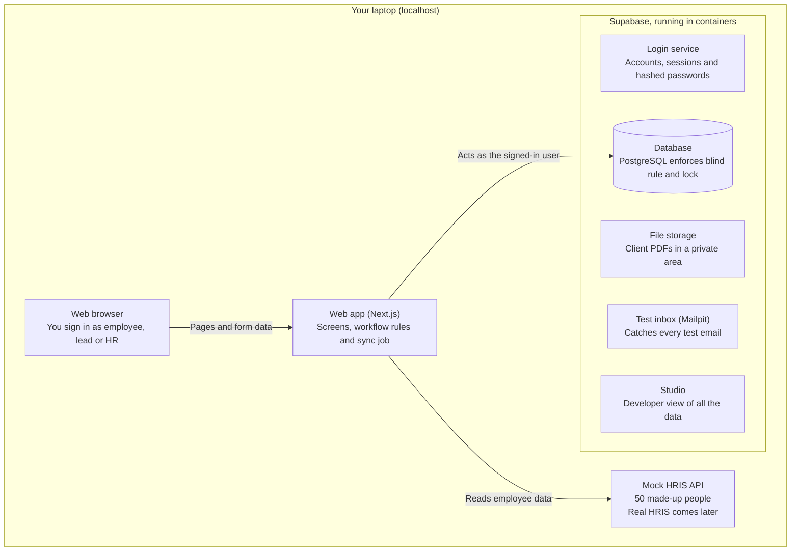
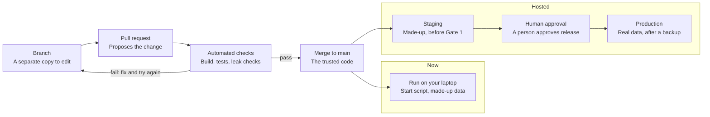
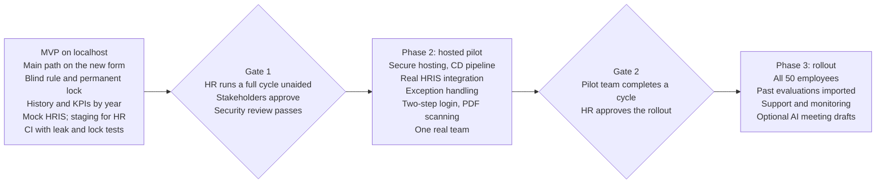

# Performance Evaluation System — Architecture

Nov 9, 2026 · @Gayan

## Summary

Build one web application that runs entirely on your laptop, using made-up data and a mock HR data service. The app handles the screens and workflow, while a database called PostgreSQL stores the evaluations and refuses any request that breaks the blind rule or changes a locked rating. Because the database has the final say, a mistake in a screen can't expose hidden answers. This is a simple design for 50 to 100 employees, and it can move to secure online hosting later with few changes.

**Localhost** means software that runs only on your own computer, so nobody else can reach it through the internet.

### What this design assumes

| Topic | Assumption | Source |
| --- | --- | --- |
| Who builds it | You, directing Claude Code | Your answer |
| Who uses it now | Only you, signing in as different test users; HR tries a hosted staging copy with made-up data before Gate 1 | Your answer |
| AI | Not in the first version; a human-reviewed option comes later | Your answer |
| Growth | About 50 to 100 employees in one company | Assumed, because you left it open |
| Platform | Web only | PRD |
| Location and law | Sri Lanka, with its Personal Data Protection Act | Your answer and the PRD |
| Deadline and budget | Neither is fixed, and local running has no hosting bill | Assumed |

## System diagram

Your browser talks only to the web app. The app reads and writes data as the signed-in user, so the database can apply that person's access rules.

The mock API is the only part that gets replaced for real HRIS integration, and hosting moves the other parts online later.

## Components

Each part has one clear job, and all of them run on your laptop.

| Part | What it does | Why it's needed |
| --- | --- | --- |
| **Frontend** (what people see in the browser) | Shows login, tasks, the form, history and the HR dashboard | Gives each role its screens |
| **Backend** (logic that runs out of sight) | Validates input, moves forms between stages and starts the sync | Keeps the rules away from the browser, where they could be changed |
| **Database** (organized long-term storage) | Stores users, forms, answers, ratings and the audit log | Holds the records, and enforces the blind rule and lock |
| **Login service** | Handles accounts, invites, passwords and sessions | Avoids writing sensitive login code from scratch |
| **File storage** | Keeps client PDFs in a private area | PDFs don't belong in database tables, and they need access checks |
| **Mock HRIS API** (a pretend version of the HR system) | Returns 50 made-up employees and can simulate failures | Lets you build and test without the real HR system |
| **Sync job** | Reads the mock API and updates local employee records | Follows the same path the real integration will use |
| **Test inbox** | Catches every email and displays it locally | Lets you test invites and reminders without sending real email |
| **Audit log** | Permanently records sensitive actions and refused access | Shows who did what, and when |
| **Automated tests** | Try to break the blind rule and the lock on every code change | Provide the main safety check when AI writes most of the code |
| Scheduler (pg\_cron) | Runs a deadline job every 15 minutes inside the database | Moves overdue forms to In dispute and queues reminders, even when nobody is signed in |
| Email outbox | A table of emails waiting to be sent, which the web app sends and marks done | Keeps email sending out of the database, and lets failed emails be retried |

An **API** is a defined way for one piece of software to request data from another.

## Technology stack

The recommendation keeps the PRD's choices, because one tool can supply the database, login and file storage on your laptop.

| Need | Recommended | Why | Simpler or cheaper alternative |
| --- | --- | --- | --- |
| Screens and backend | Next.js with TypeScript | One codebase for both, and TypeScript catches many errors early | Express with server-made pages: fewer concepts, but more to assemble |
| Database, login and files | [Supabase running locally](https://supabase.com/docs/guides/local-development/cli/getting-started) | Includes PostgreSQL, login, storage and a test inbox in one command | PostgreSQL alone, with login and file handling built separately |
| Running Supabase | A container tool; [Supabase recommends OrbStack on macOS](https://supabase.com/docs/guides/local-development/cli/getting-started) | Containers are sealed packages that run software the same way on any computer | Docker Desktop or Colima |
| Styling and forms | Tailwind CSS and shadcn/ui | Ready-made accessible parts speed up the many forms | Plain CSS |
| Input checks | Zod | One set of rules for checking every form's data | Hand-written checks |
| Mock HRIS API | A small separate Hono service | Keeps it apart from the app, like the real HRIS | Extra routes inside the Next.js app |
| Scheduled jobs | pg\_cron, Supabase's built-in scheduler, plus a "Sync now" button | Works the same locally and hosted, and tests can run each job on demand | A timer in the web app, which stops whenever the app stops |
| Tests | Playwright | Tests screens and APIs in one tool, and suits your QA background | No simpler option is recommended |
| Code history | Git and a private GitHub repository | Tracks every change and allows rollback | Git on your laptop only, which risks loss |
| Automated checks and releases | GitHub Actions | Lives beside the code, and can run the app and database tests on each change | Run the same test script by hand before each merge, which is easier to forget |
| Email once hosted | The company's existing Microsoft 365 or Google Workspace, if it allows app sending | Likely already an approved provider, which simplifies the legal review | A dedicated email service such as Postmark or Resend, which needs its own review |

Check the license of your container tool before using it for company work. Docker's [pricing page](https://www.docker.com/pricing/) doesn't state the limits for commercial use.

## Data design

The most important decision is to store the employee's and lead's answers in separate database rows, so the database can hide one without the other. At this stage, all data is made up and stays on your laptop.

| Data | Where it's stored | Who can read it | How it's protected |
| --- | --- | --- | --- |
| Employee details and reporting lines | Database, copied from the mock API | The person, their lead and HR | Read-only in this system |
| Passwords | Login service | Nobody | Stored as hashes, a one-way scramble that can't be reversed |
| Form template versions | Database | All signed-in users, for their own forms | Can't be changed once used |
| KPIs | Database | Employee, lead and HR | Frozen at the first submission |
| Each person's answers | Database, one row per side | The author until the reveal; then employee, lead and HR | Database access rules hide the other side |
| Final ratings | Database | Employee, lead and HR | Database rejects changes after locking |
| Client PDFs | Private file storage | HR and lead before the reveal; then the employee too | Opened only through a route that checks the signed-in user each time |
| Audit log | Database | HR and the administrator | Records can be added, but never edited |

Each form keeps its own copy of the template, employee details and lead details once final. Later changes therefore can't rewrite history, which is how past years stay accurate as web pages.

Turn on full-disk encryption on your laptop, and don't put real employee data in the local system.

## Security

Three layers check every request, so a mistake in one doesn't expose an evaluation: the screen hides what you can't use, the backend checks your role and the form's stage, and the database applies its own rules.

| Area | Design |
| --- | --- |
| Login (proving who you are) | Company email and a self-chosen password of at least 12 characters, set through an invite |
| Permissions (deciding what you can do) | PRD roles of employee, lead, HR and administrator, checked by the backend and the database |
| Blind rule | **Row-level security**, a database rule on each row, returns the other side's answers only after the reveal |
| Permanent lock | A **database trigger**, an automatic check on every change, rejects edits to forms in a final state |
| Audit log | Triggers record changes; read functions record HR reads and refusals, because triggers don't run when data is only read; nobody can edit or delete records |
| Master key | Supabase's service key skips access rules, so it stays on the server and is used only for tightly limited jobs such as the sync |
| Client PDFs | Private storage, opened only through a signed-in route, with no shareable links |
| Secrets | Passwords and keys stay in a local settings file that's never added to GitHub |
| Local exposure | Services listen on your laptop only, not your office network |
| Stage changes | Users can't update a form's stage directly; one function applies the Stage moves table, a trigger rejects any other change, and tables and helper functions stay out of the automatic API |
| Sensitive reads | Data tables are kept out of Supabase's automatic API, so every read goes through functions that check permission and log HR reads and refusals |
| Time | Every rule reads one "current time" function, which tests can set to any date |

### Compliance

The localhost stage uses made-up data, so it doesn't process real employees' personal data. Before the pilot, [Sri Lanka's Personal Data Protection Act](https://dpa.gov.lk/acts/22-2025_E_251104_201549.pdf) needs a legal review, because its [key provisions take effect on 1 January 2027](https://www.ft.lk/front-page/Data-protection-compliance-regime-takes-effect-on-1-Jan-2027/44-795776). That review should cover employee evaluations, retention periods, breach notices and every outside service that handles personal data: hosting, email, error monitoring and any later AI service, including where each stores data.

This design doesn't replace legal advice.

## Scalability

One application and one database should comfortably handle 50 to 100 employees, so the first version needs no special scaling work. The busiest time will be the days before a review deadline, not a constant flow of traffic.

| Size | What changes |
| --- | --- |
| Localhost: you alone | Nothing |
| Hosted: 50 to 100 employees | One hosted app and one managed database |
| 100 to 500 employees | Add database indexes (lookup shortcuts) and split long lists into pages, based on measured slowdowns |
| More than 500, or several companies | Larger database plan and a data redesign for multiple companies; this would be a separate project |

## Hosting and costs

Building runs only on localhost, with no hosting bill or public address. Near the end of the MVP, a hosted staging copy with made-up data lets HR try the system before Gate 1.

| Service on your laptop | Address |
| --- | --- |
| Web app | localhost:3000 |
| Mock HRIS API | localhost:4000 |
| Supabase API | [localhost:54321](https://supabase.com/docs/guides/local-development/cli/getting-started) |
| Database | localhost:54322 |
| Supabase Studio, a screen for viewing data | localhost:54323 |
| Test email inbox | localhost:54324 |

The Supabase addresses are its defaults, while 3000 and 4000 are this project's choices.

### Monthly cost estimates

| Stage | Estimate | Basis |
| --- | --- | --- |
| Localhost, now | $0 for hosting | Excludes any Claude Code plan and container-tool license |
| Hosted launch, 50 employees | From $45 | [Supabase Pro from $25](https://supabase.com/pricing) and [Vercel Pro from $20](https://vercel.com/pricing), before email and malware scanning |
| At scale, 100 to 500 employees | Roughly $50 to $150 | My rough estimate, to re-check with real usage |
| Staging for HR, before Gate 1 | From $45 | Same paid plans as launch; free plans pause after inactivity |

Prices were checked on 9 November 2026. Choosing the hosting location is a pilot decision that depends on the legal review.

## DevOps and CI/CD

Use **continuous integration (CI)** from the first day, so automated checks test every change before it joins the main code. **Continuous delivery (CD)** starts when the staging copy goes online near the end of the MVP, because nothing is hosted before then.

**DevOps** is the practice of building, testing, releasing and running software reliably. A **pipeline** is the automated series of steps that does this. In plain terms, CI means "prove the change works", while CD means "deliver it safely to a hosted environment".

Use a single main branch with short-lived branches for changes. [Supabase's guide](https://supabase.com/docs/guides/deployment/managing-environments) shows a separate `develop` branch, but one main branch is simpler for one builder. Changes from you and Claude Code follow the same path.

### CI checks on every pull request

These run on GitHub Actions, GitHub's automation service. Any failure blocks the merge.

| Order | Check | What it proves |
| --- | --- | --- |
| 1 | Install and build | The app still builds from a clean start |
| 2 | Code style and type checks | Common coding errors are caught early |
| 3 | Unit tests | Individual rules work, such as stage moves and deadlines |
| 4 | Rebuild the database | Migrations work from empty, and generated types match |
| 5 | Permission, lock and leak tests | Each role is refused what it shouldn't see or change, including direct stage changes through Supabase's API |
| 6 | Main-path browser test | A complete made-up cycle works from opening to the locked history page |
| 7 | Secret and dependency scans | No keys were committed, and third-party code has no known serious flaw |
| 8 | Time-based rules | Reminders and disputes happen at the right moment, with time moved forward in the test |

CI uses a temporary environment with made-up data, and it's deleted after each run. GitHub currently [includes $12 of Actions usage a month on its Free plan](https://docs.github.com/en/billing/concepts/product-billing/github-actions), which I calculate as about 2,000 standard Linux minutes for a private repository.

### Environments

An **environment** is a separate running copy of the system, so tests can't affect real records.

| Environment | When | Data | How it updates |
| --- | --- | --- | --- |
| Local | Now | Made-up | Start script on your laptop |
| CI | Now | Made-up, temporary | Automatically for each pull request |
| Staging, a private hosted test copy | Near the end of the MVP | Made-up | Automatically after a merge to main |
| Production, the live system | Phase 2 onward | Real | Only after staging tests and human approval |

### Release and recovery rules

- **Database changes:** every change is a migration in Git, and nobody edits staging or production by hand.
- **Backups:** production gets a backup before each release that changes the database.
- **Undoing a bad release:** the app can return to its previous version, while a database mistake is fixed by a new migration or a tested restore.
- **Secrets:** staging and production keys are stored separately in the hosting and GitHub secret stores, never in code.
- **Security-sensitive changes:** access rules and the master key's use get extra human review before merging.
- **Real data:** production data never gets copied into local, CI or staging.

### Monitoring from Phase 2

Production needs error alerts, uptime checks, sync failure alerts and backup checks. The support owner receives these alerts, and logs must never contain evaluation answers or ratings.

### DevOps by phase

| Phase | What's added |
| --- | --- |
| MVP on localhost | Private GitHub repository, protected main branch, CI checks, a one-command local start and, before Gate 1, staging for HR with automatic delivery |
| Phase 2: hosted pilot | Production, approved release to production, secret stores, monitoring and a tested restore |
| Phase 3: rollout | Regular dependency updates, scheduled restore tests and release notes for HR |

## AI layer: later option

No AI is built in the first version, and the first AI feature shouldn't be an agent. An **AI agent** decides its own steps and acts on them, while evaluations need something narrower: one AI request that drafts text for a person to review.

The proposed feature helps a lead prepare for the meeting by drafting a neutral summary of where the two evaluations agree and differ. The lead can edit or discard it, and it never becomes a rating by itself.

### Loop engineering

1. **Task:** after the reveal, the lead clicks "Draft meeting summary".
2. **Action:** the backend removes names and sends only that form's answers to the AI once.
3. **Check result:** code confirms the required format, that no ratings are recommended and that every point refers to the answers.
4. **Retry or stop:** it retries once if a check fails, then stops and says no draft is available.
5. **Hand over:** a draft always goes to the lead, labeled as AI-generated, and the meeting continues normally without it.

### Harness engineering

The **harness** is everything around the AI that controls what it can see and do.

| Control | Rule |
| --- | --- |
| Tools | None: the AI receives text and returns text, and can't reach the database |
| Data it can see | One revealed form, with names replaced; no hidden answers, other employees or client PDFs |
| What it must never do | Suggest or change ratings, read data before the reveal, write to records, or send anything |
| Human approval | The lead reviews every draft, and the employee doesn't see it unless the lead shares it |
| Verifying output | Automatic format and rating checks, then the lead's review |
| Monitoring | Log who asked, when, the prompt version, cost and whether the draft was used, without storing answers in logs |
| Preventing repeat mistakes | Each reported error becomes a new test case before the prompt changes |

Instructions hidden inside an evaluation or PDF are treated only as text to summarize, and they can't grant the AI any access.

### Testing and cost

Test with **evals**, a fixed set of cases that score AI output. Start with 30 to 50 made-up evaluation pairs, checking for invented facts, missing disagreements, unfair language and any rating advice.

| Assumption | Estimate |
| --- | --- |
| Model and price | Claude Opus 5.5: $4 per million input tokens and $20 per million output tokens, from Anthropic's price list as of 6 October 2026 |
| One draft | About 5,000 input and 1,000 output tokens, costing about $0.04 |
| One cycle at 50 employees | About $2, or at most $6 with up to three drafts each |
| One cycle at 100 employees | About $4, or at most $12 with up to three drafts each |

A **token** is a small piece of text that AI services use for billing. These token counts are assumptions until tested. Sending evaluations to an AI service is also a privacy decision, so the Sri Lanka legal review must approve it first.

## Phased roadmap

The **MVP**, or minimum viable product, is the smallest version people can really try. Here it stays on your laptop until it's been approved.

Within the MVP, build the main path first and then add exception handling. Before Gate 1, put a staging copy with made-up data online so HR can run a cycle themselves. Dates depend on when the work starts and how quickly each part passes its tests.

## Risks and trade-offs

The largest risk is AI-written access rules that look right but leak hidden answers, so the tests must try to break them from outside the app.

| Risk | What could go wrong | Response |
| --- | --- | --- |
| Blind rule leak | A rule or API route exposes the other side's answers | Test every role and stage directly against the database and Supabase's API |
| Master key misuse | Code using the key skips all access rules | Allow it only in a few reviewed server functions, and search for it in code reviews |
| Laptop failure | Code or test setup is lost | Push code to private GitHub, and recreate the database from scripts |
| Local isn't real life | Email, session ending and upload limits may behave differently online | Repeat those tests on a hosted test copy before the pilot |
| Mock differs from the real HRIS | Fields or failure types don't match | Keep HRIS code separate, and review the real API before integration |
| Complex rules are hard to maintain | Database rules are harder to read than normal code | Keep them short, explain each one and cover it with tests |
| A real person's data enters the system | Sample files or real names get used locally | Use made-up data only, and generate it with a script |
| Direct API reads | Someone tries to read tables directly through the automatic API | Keep tables out of the automatic API, and confirm in CI that they can't be reached |

### Decisions and why

| Decision | Chosen | Instead of | Why |
| --- | --- | --- | --- |
| Where rules are enforced | Database and backend | Backend only | Protects hidden answers even if a route has a mistake |
| System shape | One app | Separate small services | Far simpler for one builder and 50 to 100 users |
| Login | Supabase's login service | Custom login | Less sensitive code to write and secure |
| Mock | Separate small service | Built into the app | Matches the real integration, for slightly more setup |
| Stage | Localhost | Hosted from day one | No cost or exposure, but hosted behavior stays untested |
| AI | Later, human-reviewed drafts | AI in the first version | Keeps sensitive data out of AI services until the core is proven |
| Release pipeline | CI now, CD once staging is online | Full CI/CD from day one | Protects code quality now, without building deployment for a system that isn't hosted |
| HR trial before Gate 1 | Hosted staging with made-up data | Screen share, or a tunnel to your laptop | Lets HR run a cycle without help, as Gate 1 requires, without exposing your laptop |

## Developer handover

Claude Code or a developer can start once these items are ready.

The [design document](https://claude.ai/artifact/Mc9ekbhBrhwADV8dkBdMpb) holds the detailed tables, functions, screens, tests and build order.

- [ ] Read the [PRD](https://claude.ai/artifact/LEAKJyo3GHrh6NNeaXp55s) and this design
- [ ] Install Node.js, Git, a container tool and the Supabase command-line tool
- [ ] Create a private GitHub repository, protect its main branch and require pull requests
- [ ] Create the Next.js app, local Supabase project and mock HRIS service
- [ ] Write database setup as scripts called **migrations**, so anyone can rebuild it
- [ ] Generate 50 made-up employees and test logins for each role
- [ ] Build access rules and API tests for the blind rule and lock first, before the screens
- [ ] Build the main path from the PRD's demo requirements, using the stage moves as the rulebook
- [ ] Set up GitHub Actions with the CI checks in this document, and block merges that fail
- [ ] Write a one-command start script and a short README file with setup steps
- [ ] Enable pg\_cron, and add the "current time" function before writing any deadline rule
- [ ] Route stage changes and HR reads through checked, logged functions
- [ ] Before Gate 1, set up a hosted staging copy with made-up data for HR

## Self-review

The design is sound for one company, but its biggest weakness is that one person will rely on AI-written security rules. This is my own review, so an independent security review should still happen before the pilot.

### Weak spots

- **Security depends on tests:** you can test behavior well, but a security specialist should review access rules before real data.
- **Localhost proves only part of it:** email delivery, session ending, 20 MB uploads and backup restores need checking on a hosted copy.
- **Immediate session ending may need extra work:** login sessions may stay valid until they expire, which affects suspending someone's access (X7).
- **PDF backups need checking:** database backups may not include stored files, so confirm this before the pilot.
- **One-company assumption:** adding multiple companies later would mean significant rework, which is acceptable for an internal tool.
- **Long-term ownership is open:** nobody has been named to maintain the system after you build it.
- Every read depends on correctly written functions: one missing permission check would expose data, so each function needs its own refusal tests.

### Possible overengineering

- **PRD demo scope:** 40 of 59 requirements is a lot for a first build. Start with the single main path, then add others.
- **Separate mock service:** routes inside the app are simpler at first, though a separate service better matches integration.
- **Sync rules:** a seed script could replace most sync behavior until integration work starts.
- **Three layers of permission checks:** this is the one extra cost I'd keep, because it protects the product's core promise.
- CI size: a full pipeline can slow one builder. Start with build, migration, permission and lock checks, then add browser and scanning checks once the main path works.

### Simpler options to consider

| Option | Benefit | Cost |
| --- | --- | --- |
| Build the main path first, and postpone all exception handling | Fastest way to something HR can react to | Exceptions must be added before real use |
| Load a fixed employee file, with no mock API at first | Removes a service and sync logic | The mock API you asked for arrives later |
| Use Supabase's hosted free plan instead of localhost | Avoids container setup | Conflicts with your localhost decision, and projects [pause after a week of inactivity](https://supabase.com/pricing) |

My recommendation is the first option: keep this architecture, but build only the main path before adding the rest.

### Corrections after an outside review

A later review asked five questions that exposed gaps in this design. The sections above now include these changes.

| Question | What was wrong or missing | Change made |
| --- | --- | --- |
| Scheduled jobs and simulated time | No scheduler was named | pg\_cron, an email outbox and one "current time" function that tests can set |
| Logging reads and refusals | The design said triggers would log reads, but triggers only run on changes | Tables are kept out of the automatic API, and every read goes through checked, logged functions |
| Stage changes through the API | It wasn't shown how direct edits are stopped | No direct update permission, one checked function, a backstop trigger and a CI test for every role |
| HR trying the system before Gate 1 | Localhost only couldn't meet the gate | A hosted staging copy with made-up data near the end of the MVP |
| Email service and data location | No service was chosen or listed for legal review | Prefer the company's existing email provider, and list every outside service in the legal review |
