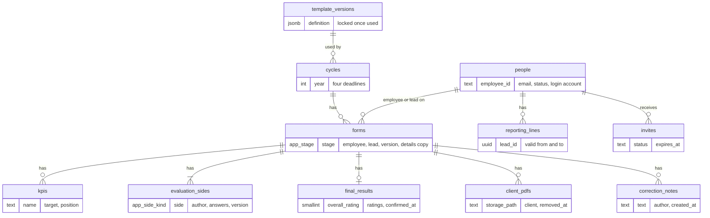
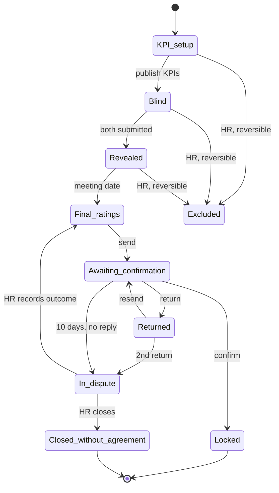

# Performance Evaluation System — Design

Nov 11, 2026 · @Gayan

## Overview

This document turns the [architecture](https://claude.ai/artifact/Top5ncegEutVM7mUtTHsmg) into detailed build instructions for the localhost MVP, including tables, functions, screens and tests. The [PRD](https://claude.ai/artifact/LEAKJyo3GHrh6NNeaXp55s) remains the source for what the system must do, and its requirement IDs such as E4 are used throughout.

It's written for you and Claude Code, so each technical term is explained briefly where it first appears. Pilot-only parts are marked so they aren't built too early.

### The system in five lines

1. An internal web app replaces evaluation spreadsheets for about 50 employees in one company in Sri Lanka.
2. Employees complete a private self-evaluation, see their lead's evaluation only after both submit, then confirm or return the final ratings.
3. Leads set KPIs, evaluate privately, hold the meeting and enter agreed final ratings, which lock permanently.
4. HR runs cycles, sends invites, tracks progress, uploads client PDFs, handles disputes and reads history; an administrator manages the HR role.
5. The MVP runs on localhost with made-up data and a mock HR system, with a hosted staging copy for HR before Gate 1.

### Changes from the architecture

| Change | Why |
| --- | --- |
| Data tables sit in a private database area that Supabase's automatic API doesn't publish | The API can reach only approved functions, so direct-read attempts become impossible instead of unlogged |
| Every read or change of evaluation data goes through a database function | One place checks permission, applies the stage rules and writes the audit record |
| Emails are sent by a web app job that the scheduler calls every minute | Keeps email code out of the database while still running on a timetable |

The first change closes the logging gap listed in the architecture's self-review, and the architecture has been updated to match.

## Traceability

Every PRD requirement, quality requirement and screen is mapped below. Covered means fully designed here, partly covered means only part of the design is here, and later means it's scheduled for a later phase.

### Functional requirements

| ID | Where this design covers it | Status |
| --- | --- | --- |
| A1 | Mock HRIS and sync, `people`, `reporting_lines` | Covered |
| A2 | Login and sessions, `invites`, `/auth/set-password` | Covered |
| A3 | Login and sessions: lockout and reset | Covered |
| A4 | Access rules, navigation in User experience | Covered |
| A5 | `hr_send_invite`, `invites`, HR people screen | Covered |
| C1 | `hr_open_cycle`, `/hr/cycles/new` | Covered |
| C2 | `template_versions`; template editing screen | Later: pilot |
| C3 | `template_versions` locked once used | Covered |
| C4, C5 | `publish_kpis`, Simultaneous actions | Covered |
| E1 to E6 | `save_draft`, `submit_side`, `get_form`, Form stages | Covered |
| P1 to P4 | `begin_pdf_upload`, `register_client_pdf`, `/files/pdf/[id]` | Covered; malware scan in pilot |
| P5 | PDFs stream through a signed-in route, never a shareable link | Covered |
| P6 | `remove_client_pdf` | Later: pilot |
| F1 to F5 | Final ratings functions and Form stages | Covered |
| H1 to H3, H5 | `get_history`, history screen | Covered |
| H4 | `get_rating_trend` | Later: pilot |
| H6 | `hr_import_evaluation` | Later: rollout |
| H7 | `hr_export_record` | Later: pilot |
| R1 | `get_hr_dashboard`, `/hr` | Covered |
| R2 | Email outbox, Notifications in the PRD | Covered |
| R3 | `hr_export_status` | Later: pilot |
| X2, X6, X8, X9, X10 | HR functions, Audit events | Covered |
| X1, X3 to X5, X7 | HR exception functions | Later: pilot |
| S1 to S3, S9, S10 | Mock HRIS and sync, daily sync job | Covered |
| S4 to S8, S11, S12 | Sync rules, lead-change approval | Later: pilot |

### Quality requirements and screens

| Item | Where this design covers it | Status |
| --- | --- | --- |
| Access control | Database access design, Routes to the data | Covered |
| Passwords and sessions | Login and sessions | Covered; two-step login in pilot |
| Encryption | Localhost has no network traffic; hosting settings come later | Later: staging |
| Audit log | Audit events | Covered |
| Privacy, backups, production access, monitoring | Hosting rules in the architecture | Later: pilot |
| Record deletion | `admin_delete_record` | Later: pilot |
| Performance | Indexes in Schema details | Partly: load test in pilot |
| Browsers and accessibility | Design system, Components, Test design | Covered |
| Demo data, time and language | Test design, Scheduler | Covered |
| HRIS connection | Mock HRIS and sync, master key list | Covered |
| Screens 1 to 8 in the PRD | Screens and routes, Screen states | Covered |

### Not asked for by any requirement

These support the requirements and are intended: the test clock, version numbers on records, the `CHANGED_ELSEWHERE` error, autosave timing, failed-login records and the phone layout for side-by-side views.

### Contradictions found and fixed

| Conflict | Fix in this version |
| --- | --- |
| PDFs used shareable signed links, but P5 says a copied link must fail | PDFs now stream through a route that checks the signed-in user |
| Only HR could remove PDFs, but P6 also allows the lead before the reveal | `remove_client_pdf` follows P6 |
| The PRD puts daily sync (S1) in the demo, but this design left it for the pilot | A daily sync job is now in the MVP |
| R3, H4 and record deletion had no function | Added as pilot functions |

## Code structure

Everything lives in one repository, a single tracked folder of code in Git, so one change can update the screens, database and tests together.

| Folder | What it holds |
| --- | --- |
| `app/` | Next.js pages and server actions; a **server action** is backend code that a page calls directly |
| `app/api/jobs/` | Protected job endpoints, such as sending queued emails |
| `components/` | Shared screen parts, such as rating fields, tables and stage badges |
| `lib/` | Supabase connection helpers, Zod input rules, error messages and date helpers |
| `supabase/migrations/` | Numbered SQL scripts that build the database step by step |
| `supabase/seed/` | Made-up template, cycle and test login data |
| `supabase/tests/` | Database tests for access rules, stage moves and functions |
| `mock-hris/` | The separate mock HR data service and its scenarios |
| `tests/api/` | Tests that call the database functions as each role |
| `tests/e2e/` | Playwright browser tests for complete journeys |
| `scripts/` | One-command start, reset and test-data scripts |
| `.github/workflows/` | CI pipeline settings |
| `docs/` | Extra notes only; PRD.md, ARCHITECTURE.md, DESIGN.md, RULES.md and TASKS.md stay in the repository root |
| features/\<area>/ | Feature code and server actions for forms, KPIs, final ratings, history, HR and admin |
| types/ | Shared TypeScript types and generated database types |
| tests/unit/ | Vitest unit tests |

The browser never connects to Supabase directly. Pages call server actions, and server actions call database functions while signed in as the current user.

### Configuration

All settings are environment variables in `.env.local`, which Git ignores. A committed `.env.example` lists every name with safe local values. The browser never receives any of them.

| Variable | Used by | Local value | Secret |
| --- | --- | --- | --- |
| `SUPABASE_URL` | Server | `http://localhost:54321` | No |
| `SUPABASE_PUBLISHABLE_KEY` | Server, acting as the signed-in user | From `supabase status` | No |
| `SUPABASE_SECRET_KEY` | `lib/server/service-client.ts` only | From `supabase status` | Yes |
| `APP_URL` | Invite links and email links | `http://localhost:3000` | No |
| `HRIS_API_URL` | Sync job | `http://localhost:4000` | No |
| `HRIS_API_KEY` | Sync job and the mock HRIS | Any long random value | Yes |
| `JOB_SECRET` | Job endpoints and the scheduler | Any long random value | Yes |
| `SMTP_HOST`, `SMTP_PORT` | Email sending | `localhost`, `54325` (Mailpit) | No |
| `SMTP_USER`, `SMTP_PASSWORD` | Email sending once hosted | Empty locally | Yes |
| `EMAIL_FROM` | Email sending | `no-reply@example.test` | No |
| `TEST_CLOCK_ALLOWED` | Test clock guard | `true` locally and in CI; unset when hosted | No |

The scheduler reads `JOB_SECRET` and `APP_URL` from Supabase Vault, Supabase's encrypted secret store, so the secret never sits in a migration file. Check the local Mailpit SMTP port in `supabase status` during setup.

## Data model

The form is the centre of the design: answers, KPIs, results and PDFs all belong to one form, and only the form holds the stage.



System records (`audit_events`, `email_outbox`, `sync_runs`) can point to any record above.

| Table | Key fields | Rules |
| --- | --- | --- |
| `people` | id, employee\_id, full name, email, job title, department, employment status, suspended, login account | Synced from HRIS fields; never edited by hand |
| `user_roles` | person, role (HR or administrator) | Lead access comes from reporting lines, not this table |
| `reporting_lines` | employee, lead, valid from, valid to | One current lead per employee |
| `pending_lead_changes` | employee, old lead, new lead, HR decision | Pilot |
| `invites` | person, status, sent, expires | Expires after 7 days |
| `template_versions` | name, version, definition | Can't change once a form uses it |
| `cycles` | name, year, template version, four deadlines | One annual review per cycle |
| `holidays` | date, name | Used for working-day counts |
| `forms` | cycle, employee, lead, temporary lead, stage, previous stage, meeting date, return count, last sent, version, details copy, imported | One per employee per cycle |
| `kpis` | form, position, name, target | 3 to 6 per form; frozen at first submission |
| `evaluation_sides` | form, side, author, answers, KPI results, submitted, version | One employee side and one lead side per form |
| `final_results` | form, agreed ratings, overall rating, objectives, summary, employee comment, sent, confirmed | Unchangeable once confirmed |
| `form_returns` | form, reason, by, when | Counts toward the dispute rule |
| `client_pdfs` | form, file path, client, evaluation date, uploaded by, removed | Files stay in private storage |
| `correction_notes` | form, text, author, created | Only on final forms |
| `audit_events` | who, action, record, reason, details, when | Add-only |
| `email_outbox` | person, template, details, status, attempts, send after | No answers or ratings |
| `sync_runs`, `sync_errors` | start, result, changes, rejected records | Visible to HR |
| `test_clock` | fake time | Local and CI only |

Answers are stored as JSON, a structured text format, matched to the template's question IDs. This keeps the form flexible, and the database functions check the answers against the template.

### Template and answer formats

These are the exact JSON shapes for the form, so no part of it needs guessing. Unknown keys are refused, text fields hold at most 4,000 characters, and ratings are whole numbers from 1 to 5.

The template stored in `template_versions.definition`:

```json
{
  "rating_scale": [
    { "value": 5, "label": "Outstanding", "meaning": "Far above the target, with impact beyond the role" },
    { "value": 4, "label": "Exceeds expectations", "meaning": "Above the target on a consistent basis" },
    { "value": 3, "label": "Meets expectations", "meaning": "Reached the target, with solid performance" },
    { "value": 2, "label": "Partially meets expectations", "meaning": "Reached some of the target, and needs improvement" },
    { "value": 1, "label": "Below expectations", "meaning": "Missed the target, and needs a clear improvement plan" }
  ],
  "comment_required_for": [1, 2, 5],
  "sections": [
    { "id": "kpis", "type": "kpi_results", "min_kpis": 3, "max_kpis": 6 },
    { "id": "competencies", "type": "rating_list", "items": [
      { "id": "quality_of_work", "label": "Quality of work" },
      { "id": "ownership", "label": "Ownership" },
      { "id": "collaboration", "label": "Collaboration" },
      { "id": "communication", "label": "Communication" },
      { "id": "learning", "label": "Learning" } ] },
    { "id": "overall", "type": "questions", "questions": [
      { "id": "overall_rating", "type": "rating", "required": true },
      { "id": "achievements", "type": "text", "required": true },
      { "id": "challenges", "type": "text", "required": true } ] },
    { "id": "development", "type": "objectives", "min": 1, "max": 3 }
  ]
}
```

Each side's `answers` in `evaluation_sides`:

```json
{
  "competencies": { "quality_of_work": { "rating": 3, "example": "text" } },
  "overall": { "overall_rating": 4, "achievements": "text", "challenges": "text" },
  "development": [ { "objective": "text", "action": "text", "support": "text or empty" } ]
}
```

Each side's `kpi_results`, with one entry per KPI:

```json
[ { "kpi_position": 1, "result": "text", "completion_pct": 80, "rating": 4, "evidence": "text" } ]
```

`completion_pct` is 0 to 100, or `null` when a KPI has no numeric target. The fields in `final_results` use the same shapes:

```json
{
  "kpi_ratings": [ { "kpi_position": 1, "rating": 4, "comment": "text" } ],
  "competency_ratings": [ { "id": "quality_of_work", "rating": 4, "comment": "text" } ],
  "development_objectives": [ { "objective": "text", "action": "text", "support": "text" } ]
}
```

A rating of 1, 2 or 5 needs text in that item's `example`, `evidence` or `comment` field. Drafts may be incomplete; `submit_side` and `send_for_confirmation` require every field.

### Schema details

This is the exact table definition Claude Code should build, written in SQL, the language databases use. `not null` means required, `references` links to another table, `check` is a rule the database enforces, and an index is a lookup shortcut for speed.

```sql
-- Schema app: not published by the automatic API
create type app.stage as enum ('kpi_setup','blind','revealed','final_ratings',
  'awaiting_confirmation','returned','in_dispute','locked','closed_without_agreement','excluded');
create type app.side_kind as enum ('employee','lead');
create type app.employment_status as enum ('active','on_leave','terminated');
create type app.role as enum ('hr','admin');

create table app.people (
  id uuid primary key default gen_random_uuid(),
  employee_id text not null unique,
  full_name text not null check (length(full_name) between 1 and 200),
  email text not null,
  job_title text not null,
  department text not null,
  employment_status app.employment_status not null,
  start_date date not null,
  is_suspended boolean not null default false,
  auth_user_id uuid unique references auth.users(id),
  hris_updated_at timestamptz,
  created_at timestamptz not null default now(),
  updated_at timestamptz not null default now());
create unique index people_email_uq on app.people (lower(email));

create table app.user_roles (
  person_id uuid not null references app.people(id),
  role app.role not null,
  granted_by uuid not null references app.people(id),
  granted_at timestamptz not null default now(),
  primary key (person_id, role));

create table app.reporting_lines (
  id uuid primary key default gen_random_uuid(),
  employee_id uuid not null references app.people(id),
  lead_id uuid references app.people(id),           -- null only for the most senior person
  valid_from date not null,
  valid_to date,
  check (lead_id is null or lead_id <> employee_id),
  check (valid_to is null or valid_to >= valid_from));
create unique index one_current_lead on app.reporting_lines (employee_id) where valid_to is null;
create index reporting_lines_lead on app.reporting_lines (lead_id) where valid_to is null;

create table app.invites (
  id uuid primary key default gen_random_uuid(),
  person_id uuid not null references app.people(id),
  status text not null check (status in ('sent','accepted','expired','replaced')),
  sent_at timestamptz not null,
  expires_at timestamptz not null,               -- sent_at + 7 days
  accepted_at timestamptz);
create index invites_person on app.invites (person_id, sent_at desc);

create table app.login_attempts (
  id bigint generated always as identity primary key,
  email text not null,
  succeeded boolean not null,
  attempted_at timestamptz not null default now());
create index login_attempts_recent on app.login_attempts (lower(email), attempted_at desc);

create table app.template_versions (
  id uuid primary key default gen_random_uuid(),
  name text not null,
  version int not null check (version > 0),
  definition jsonb not null,                     -- sections, questions, rating scale
  first_used_at timestamptz,                     -- set when a cycle opens; edits refused after
  unique (name, version));

create table app.cycles (
  id uuid primary key default gen_random_uuid(),
  name text not null,
  year int not null check (year between 2020 and 2100),
  template_version_id uuid not null references app.template_versions(id),
  kpi_deadline date not null,
  submission_deadline date not null,
  meeting_deadline date not null,
  confirmation_deadline date not null,
  status text not null default 'open' check (status in ('open','closed')),
  opened_by uuid not null references app.people(id),
  opened_at timestamptz not null default now(),
  check (kpi_deadline <= submission_deadline
     and submission_deadline <= meeting_deadline
     and meeting_deadline <= confirmation_deadline));

create table app.holidays (day date primary key, name text not null);

create table app.forms (
  id uuid primary key default gen_random_uuid(),
  cycle_id uuid not null references app.cycles(id),
  employee_id uuid not null references app.people(id),
  lead_id uuid not null references app.people(id),
  temp_lead_id uuid references app.people(id),   -- pilot (X5)
  stage app.stage not null default 'kpi_setup',
  stage_before_exclusion app.stage,              -- pilot (X3)
  meeting_date date,
  return_count smallint not null default 0 check (return_count between 0 and 2),
  last_sent_at timestamptz,
  deadline_overrides jsonb not null default '{}', -- pilot (X1)
  details_copy jsonb,                            -- names, titles and lead, frozen when final
  is_imported boolean not null default false,
  version int not null default 1,
  created_at timestamptz not null default now(),
  updated_at timestamptz not null default now(),
  unique (cycle_id, employee_id),
  check (lead_id <> employee_id));
create index forms_lead_stage on app.forms (lead_id, stage);
create index forms_stage on app.forms (stage);

create table app.kpis (
  id uuid primary key default gen_random_uuid(),
  form_id uuid not null references app.forms(id),
  position smallint not null check (position between 1 and 6),
  name text not null check (length(name) between 1 and 200),
  target text not null check (length(target) between 1 and 500),
  unique (form_id, position));

create table app.evaluation_sides (
  id uuid primary key default gen_random_uuid(),
  form_id uuid not null references app.forms(id),
  side app.side_kind not null,
  author_id uuid not null references app.people(id),
  answers jsonb not null default '{}',
  kpi_results jsonb not null default '[]',
  submitted_at timestamptz,
  version int not null default 1,
  updated_at timestamptz not null default now(),
  unique (form_id, side),
  check (pg_column_size(answers) + pg_column_size(kpi_results) < 200000));

create table app.final_results (
  form_id uuid primary key references app.forms(id),
  kpi_ratings jsonb not null default '[]',
  competency_ratings jsonb not null default '[]',
  overall_rating smallint check (overall_rating between 1 and 5),
  development_objectives jsonb not null default '[]',
  summary text,
  employee_comment text,
  sent_at timestamptz,
  confirmed_at timestamptz,
  version int not null default 1);

create table app.form_returns (
  id uuid primary key default gen_random_uuid(),
  form_id uuid not null references app.forms(id),
  reason text not null check (length(reason) between 10 and 2000),
  returned_by uuid not null references app.people(id),
  returned_at timestamptz not null default now());

create table app.client_pdfs (
  id uuid primary key default gen_random_uuid(),
  form_id uuid not null references app.forms(id),
  storage_path text not null unique,
  file_name text not null,
  size_bytes int not null check (size_bytes between 1 and 20971520),
  client_name text not null,
  evaluation_date date not null,
  uploaded_by uuid not null references app.people(id),
  uploaded_at timestamptz not null default now(),
  removed_at timestamptz,
  removed_by uuid references app.people(id),
  removed_reason text);
create index client_pdfs_form on app.client_pdfs (form_id) where removed_at is null;

create table app.correction_notes (
  id uuid primary key default gen_random_uuid(),
  form_id uuid not null references app.forms(id),
  text text not null check (length(text) between 10 and 2000),
  author_id uuid not null references app.people(id),
  created_at timestamptz not null default now());

create table app.audit_events (
  id bigint generated always as identity primary key,
  occurred_at timestamptz not null default now(),
  actor_id uuid references app.people(id),       -- null for system jobs
  action text not null,                          -- names from the Audit events table
  outcome text not null check (outcome in ('allowed','refused')),
  record_type text,
  record_id uuid,
  reason text,
  details jsonb not null default '{}');           -- never answers, ratings or comments
create index audit_record on app.audit_events (record_type, record_id);
create index audit_time on app.audit_events (occurred_at desc);

create table app.email_outbox (
  id uuid primary key default gen_random_uuid(),
  person_id uuid not null references app.people(id),
  template text not null,
  details jsonb not null default '{}',
  status text not null default 'pending' check (status in ('pending','sending','sent','failed','bounced')),
  attempts smallint not null default 0,
  send_after timestamptz not null default now(),
  last_error text,
  created_at timestamptz not null default now(),
  sent_at timestamptz);
create index outbox_due on app.email_outbox (send_after) where status = 'pending';

create table app.sync_runs (
  id uuid primary key default gen_random_uuid(),
  trigger text not null check (trigger in ('manual','scheduled')),
  status text not null check (status in ('running','succeeded','failed','paused')),
  started_at timestamptz not null default now(),
  finished_at timestamptz,
  added int not null default 0, updated int not null default 0, rejected int not null default 0,
  error text);
create table app.sync_errors (
  id uuid primary key default gen_random_uuid(),
  sync_run_id uuid not null references app.sync_runs(id),
  employee_id text,
  problem text not null);

create table app.test_clock (
  id boolean primary key default true check (id),  -- one row at most
  fake_now timestamptz not null);
```

Every table also gets: row-level security turned on and forced, a policy that gives the app\_owner role full access, no permissions for the `anon` (signed-out) role, and an automatic `updated_at` trigger where the column exists. `audit_events` gets a trigger that refuses every update and delete. `pending_lead_changes` is added in the pilot.

## Form stages

Only `app.move_stage` can change a form's stage, and it accepts only the moves drawn here. This is the same rulebook as the PRD's Stage moves table.



Excluded can be reached by HR from any stage before a final state, and reversed while the cycle is open.

| Move | Function that triggers it | Phase |
| --- | --- | --- |
| KPI setup to Blind | `publish_kpis` | MVP |
| Blind to Revealed | `submit_side`, when the second side submits | MVP |
| Revealed to Final ratings | `record_meeting` | MVP |
| Final ratings to Awaiting confirmation | `send_for_confirmation` | MVP |
| Awaiting confirmation to Locked | `confirm_final` | MVP |
| Awaiting confirmation to Returned, and back | `return_final`, then `send_for_confirmation` | MVP |
| To In dispute | `return_final` on the second return, or `jobs.process_deadlines` after 10 working days | MVP |
| In dispute to Final ratings | `hr_resolve_dispute` | MVP |
| In dispute to Closed without agreement | `hr_close_dispute` | MVP |
| Any non-final stage to Excluded, and back | `hr_exclude`, `hr_reinclude` | Pilot |

Each move writes an audit event and queues any emails listed in the PRD's Notifications table.

### Simultaneous actions

Every function that changes a form first locks that form's row. A **row lock** makes a second action on the same form wait until the first finishes, so two changes can never mix.

| Situation | Result |
| --- | --- |
| Both sides submit at the same moment | One finishes first; the second sees the other submitted and makes the single reveal. There's exactly one reveal event |
| Two browser tabs save the same draft | The save with the older version number fails with `CHANGED_ELSEWHERE`, and the screen keeps the typed text |
| HR reopens a side while its author submits | Whichever locks first wins; a reopen after the reveal fails with `STAGE_NOT_ALLOWED` |
| An employee confirms in one tab and returns in another | The first wins; the second fails with `STAGE_NOT_ALLOWED` |
| The deadline job reaches a form someone is editing | The job skips locked forms and tries again 15 minutes later |
| HR starts a sync while one is running | The second start is refused and HR is told a sync is already running |
| Two email senders run at once | Each takes different emails, so none is sent twice |

## Database access design

The database is split into three areas, called schemas, so the automatic API can reach only approved functions. Each function checks the caller and form stage itself, and row-level security checks again as a second guard.

| Schema | Holds | Reachable by the automatic API |
| --- | --- | --- |
| `app` | All tables and internal helper functions | No |
| `api` | Functions the web app may call, such as `submit_side` | Yes, for signed-in users |
| `jobs` | Scheduled and sync functions | No; only the scheduler and the server can run them |

### Function security

- **Normal functions** run with the caller's own rights, so row-level security still applies to every read.
- **Elevated functions** are owned by the app\_owner role and run with its rights. They're used only for stage moves, audit records and jobs. Each one checks permission first and fixes its search path, a setting that stops other code being substituted.
- **No direct changes:** signed-in users can't update `forms.stage`, `final_results` or `audit_events` themselves.
- **The master key** is used only by the sync and email jobs on the server.
- Owner role: app\_owner is a database role nobody can sign in as, and signed-in users aren't members of it. Forced access rules apply even to table owners, so every table has a policy giving app\_owner full access; this lets elevated functions work without switching the rules off.

### Access rules by role and stage

Row-level security applies these rules to each table. "Party" means the form's employee, lead or temporary lead.

| Data | Employee | Lead or temporary lead | HR | Administrator |
| --- | --- | --- | --- | --- |
| Form and its stage | Own | Current team | All | Status only for an HR person's form |
| Own side, before submitting | Read and edit | Read and edit | No | No |
| Other side, before the reveal | No | No | No | No |
| Both sides, from the reveal | Read | Read | Read, logged | No |
| KPIs | Read | Read and edit until the first submission | Read | No |
| Final results | Read and confirm | Read and edit until sent | Read | No |
| Client PDFs before the reveal | No | Read and upload | Read and upload | No |
| Client PDFs from the reveal | Read | Read | Read | No |
| Audit events | No | No | Read | Read |
| Email outbox and sync records | No | No | Read status | No |

HR can't use HR powers on a form where they are the employee. A pending lead change leaves access with the old lead until HR approves (S5).

### Routes to the data

Access is **deny by default**: nobody can do anything unless a rule above allows it. The same rules apply on every path to the data.

| Path | How the rules apply |
| --- | --- |
| Screens | Pages are built on the server from `api` function results only; hidden data never reaches the browser, so it isn't merely hidden by the screen |
| Server actions | Call `api` functions as the signed-in user, and never read `app` tables directly |
| Automatic API | Publishes only the `api` schema; every table is unreachable |
| File storage | One private bucket with no public links; files reach the browser only through `/files/pdf/[id]`, which checks the signed-in user each time |
| Exports | Pilot only, through `hr_export_status` (status, no answers) and `hr_export_record` (HR, logged) |
| Emails | Templates hold names, stages and links, never answers, ratings or comments |
| Logs and errors | Hold reference numbers and error codes only, never answers, ratings or comments |
| Supabase Studio | Local developer tool only; hosted access is limited to two named people |

### Master key use

The service key, Supabase's master key, bypasses every access rule. It lives only in `lib/server/service-client.ts`, and only these server files may import it:

| Use | Where |
| --- | --- |
| Send invites and password resets | `hr_send_invite` server action, after the database function approves |
| End a suspended person's sessions | Suspend server action (pilot) |
| Run the employee sync | `/api/jobs/sync` |
| Send queued emails | `/api/jobs/send-emails` |
| Upload and stream client PDFs | Upload action and `/files/pdf/[id]`, each after a database permission check |

A CI check fails the build if any other file imports the service client.

### Login and sessions

| Rule | Design |
| --- | --- |
| Sign-up | Turned off; accounts exist only through an HR invite |
| Invite | One-time link valid for 7 days; sending a new invite replaces the old one |
| Password | At least 12 characters; checked against a list of common passwords |
| Lockout | 5 failed sign-ins within 15 minutes block that account for 15 minutes. Supabase's password verification hook enforces this inside sign-in itself, so direct calls to Supabase can't skip it, and failures are recorded in `login_attempts`. Check that the hook is available on the chosen plan during T-2.4; if not, the app's sign-in page enforces the lockout and Supabase's built-in rate limits cover direct calls |
| Messages | Sign-in and reset messages never reveal whether an email exists |
| Idle timeout | Signed out after 30 minutes without activity, with a warning 2 minutes before |
| Login token life | Login tokens expire after 10 minutes and renew quietly while the person is active |
| Suspension and leavers | Every `api` function checks that the caller is active and not suspended, so access stops on the next request even if a token is still valid |
| Two-step login | HR and administrator accounts, from the pilot |

### Audit events

Each event records who, what, which record, why, when and whether it was allowed or refused. Events are written inside the same database step as the change, so a change can't happen without its record.

| Event | Recorded when |
| --- | --- |
| `auth.sign_in_failed`, `auth.locked_out` | Sign-in fails, or an email gets locked |
| `invite.sent` | HR sends or resends an invite |
| `role.granted`, `role.removed` | The administrator changes the HR role |
| `cycle.opened` | HR opens a cycle |
| `kpis.published`, `kpis.changed` | A lead publishes or edits KPIs |
| `side.submitted`, `side.reopened` | A side is submitted, or HR reopens one |
| `form.revealed` | Both sides are submitted |
| `meeting.recorded`, `final.sent` | The lead records the meeting, or sends final ratings |
| `final.returned`, `final.confirmed` | The employee returns or confirms |
| `form.disputed`, `dispute.resolved`, `dispute.closed` | A form enters dispute, or HR resolves or closes it |
| `answers.read_by_hr` | HR opens a form's answers |
| `pdf.uploaded`, `pdf.opened`, `pdf.removed` | A client PDF is added, opened or removed |
| `correction.added` | HR adds a correction note |
| `access.refused` | Any function or file route refuses a request |
| `sync.completed`, `sync.failed` | A sync run ends |
| Pilot events | Deadline extensions, exclusions, temporary leads, suspensions, lead-change decisions, exports, imports and deletions |

### Abuse cases

An **abuse case** is a way someone might misuse the system on purpose. Each one below has a test.

| Who | Attempt | What stops it |
| --- | --- | --- |
| Employee | Changes the form ID in the address to view a colleague's form | `get_form` returns `NOT_FOUND`, which doesn't reveal that the form exists |
| Employee | Calls `get_form` directly before the reveal to see the lead's answers | The lead's side is left out of the response by the database, not by the screen |
| Employee | Sends a save request for the lead's side | Refused: only a side's author can save it |
| Employee | Tries to change the stage through the automatic API | Tables aren't published, and no function sets a stage directly |
| Employee | Pastes scripts or code into a comment to attack other users | Comments are shown as plain text only, never as HTML |
| Lead | Opens a past team member's history after a lead change | Access follows the current reporting line only |
| Lead | Edits final ratings after the employee confirms | The form is locked, and the database refuses the change |
| HR | Opens answers before the reveal through the dashboard | The dashboard returns stage only |
| HR | Uses HR powers on their own form | Refused when the caller is the form's employee |
| HR | Deletes or edits audit records | No permission, and a trigger refuses it as a backstop |
| Anyone | Shares a PDF address with someone else | The route checks the signed-in user on every request |
| Anyone | Guesses passwords | Lockout after 5 failures in 15 minutes |
| Anyone | Sends a very large answer to slow the system | Size limits on answers and files |
| Anyone | Tries to act as the app\_owner role to skip access rules | Nobody can sign in as it, signed-in users can't switch to it, and a database test proves both |

## Database functions

These are the only ways the web app reads or changes evaluation data. Each writes an audit event when it changes data, reads answers as HR, or is refused.

### Functions for employees and leads

| Function | Who can call it | What it does | Requirements | Phase |
| --- | --- | --- | --- | --- |
| `get_my_tasks()` | Anyone signed in | Lists forms needing the caller's action, with due dates | R1 | MVP |
| `get_form(form_id)` | Parties and HR | Returns only what the caller may see at the current stage | E4, E6, H1 | MVP |
| `publish_kpis(form_id, kpis)` | Lead | Saves 3 to 6 KPIs and moves KPI setup to Blind; edits allowed until the first submission | C4, C5 | MVP |
| `save_draft(form_id, answers)` | Side author | Saves answers and KPI results before submitting | E1 | MVP |
| `submit_side(form_id)` | Side author | Checks required fields, locks the side and reveals the form when both have submitted | E2, E3, E5 | MVP |
| `record_meeting(form_id, date)` | Lead | Saves a past or current date and moves to Final ratings | F1 | MVP |
| `save_final(form_id, result)` | Lead | Saves agreed ratings, overall rating, objectives and summary | F2 | MVP |
| `send_for_confirmation(form_id)` | Lead | Checks completeness and moves to Awaiting confirmation | F2 | MVP |
| `confirm_final(form_id, comment)` | Employee | Locks the form permanently | F3, F4 | MVP |
| `return_final(form_id, reason)` | Employee | Returns the form to the lead, or moves it to In dispute on the second return | F3 | MVP |
| `get_history(person_id, year)` | Employee, current lead and HR | Returns final forms and KPIs for that year | H1 to H3, H5 | MVP |
| `register_client_pdf(form_id, details)` | Lead and HR | Records an uploaded PDF with client name and date, after begin\_pdf\_upload approved the upload | P1 to P4 | MVP |
| `authorize_pdf_download(pdf_id)` | By the PDF access rules | Checks access and logs it; the file then streams through /files/pdf/\[id\], so no shareable link exists | P3, P5 | MVP |
| begin\_pdf\_upload(form\_id, file) | Lead and HR | Checks access and size, and approves a storage path before the file is stored | P1, P3 | MVP |
| get\_hr\_dashboard(filters) | HR | Lists every form's stage, dates and overdue status, with no answers | R1 | MVP |

### Functions for HR and the administrator

| Function | What it does | Requirements | Phase |
| --- | --- | --- | --- |
| `hr_run_sync()` | Starts an employee sync now | S1 | MVP |
| `hr_send_invite(person_id)` | Sends or resends an invite | A5 | MVP |
| `hr_open_cycle(details, people)` | Creates a cycle and one form per included employee | C1 | MVP |
| `hr_reopen_side(form_id, side, reason)` | Reopens a submitted side before the reveal | X2 | MVP |
| `hr_resolve_dispute(form_id, outcome)` | Records the outcome and returns the form to Final ratings | X10 | MVP |
| `hr_close_dispute(form_id, reason)` | Closes a disputed form without agreement | X6 | MVP |
| `hr_add_correction_note(form_id, text)` | Adds a dated note beside a final form | F5 | MVP |
| `hr_get_audit(filters)` | Lists audit events | X8, X9 | MVP |
| `hr_extend_deadline`, `hr_exclude`, `hr_reinclude`, `hr_add_to_cycle`, `hr_assign_temp_lead`, `hr_suspend`, `hr_restore` | HR exception controls | X1, X3 to X5, X7 | Pilot |
| `hr_approve_lead_change`, `hr_confirm_reporting_lines`, `remove_client_pdf, hr_export_record, hr_export_status, get_rating_trend, admin_delete``_record` | Lead changes, cycle checks, PDF removal by the lead before the reveal or by HR, exports, rating trends and approved deletions | S5, S12, P6, H7, R3, H4, record deletion | Pilot |
| `hr_import_evaluation` | Enters an evaluation from before the system | H6 | Rollout |
| `admin_set_hr_role(person_id, on)` | Gives or removes the HR role | Users | MVP |

### Internal functions

| Function | What it does |
| --- | --- |
| `app.move_stage(form_id, to_stage, reason)` | The only code that changes a stage; rejects moves not in the Stage moves table |
| `app.log_event(...)` | Writes one audit event |
| `app.current_time()` | Returns the real time, or the test clock in local and CI |
| `app.add_working_days(date, days)` | Counts Monday to Friday in Sri Lanka time, skipping holidays HR entered |
| `app.enqueue_email(person_id, template, details)` | Adds an email to the outbox without answers or ratings |
| `jobs.process_deadlines(at)` | Sends reminders, alerts HR and moves overdue confirmations to In dispute |
| `jobs.sync_employees(records)` | Applies employee data from the mock API |

### Function contracts

Every `api` function returns either `{ "ok": true, "data": ... }` or `{ "ok": false, "error": { "code": ..., "fields": {...} } }`. Every function can also return `NOT_FOUND` and `UNEXPECTED`, so the table lists only the extra errors.

| Function | Inputs | Returns on success | Extra errors |
| --- | --- | --- | --- |
| `get_my_tasks` | none | List of { form\_id, person name, action, due date, stage } | none |
| `get_form` | form\_id | The form view below | none |
| `publish_kpis` | form\_id, version, kpis \[3 to 6 of { name, target }\] | form version | `STAGE_NOT_ALLOWED`, `VALIDATION_FAILED`, `CHANGED_ELSEWHERE` |
| `save_draft` | form\_id, side version, answers, kpi\_results | side version, saved\_at | `STAGE_NOT_ALLOWED`, `VALIDATION_FAILED`, `CHANGED_ELSEWHERE` |
| `submit_side` | form\_id, side version | new stage (Blind or Revealed) | `VALIDATION_FAILED` with each missing field, `STAGE_NOT_ALLOWED` |
| `record_meeting` | form\_id, date | new stage | `VALIDATION_FAILED`, `STAGE_NOT_ALLOWED` |
| `save_final` | form\_id, version, ratings, overall, objectives, summary | version | `VALIDATION_FAILED`, `STAGE_NOT_ALLOWED`, `CHANGED_ELSEWHERE` |
| `send_for_confirmation` | form\_id, version | new stage | `VALIDATION_FAILED`, `STAGE_NOT_ALLOWED` |
| `confirm_final` | form\_id, version, optional comment | new stage Locked | `STAGE_NOT_ALLOWED`, `CHANGED_ELSEWHERE` |
| `return_final` | form\_id, version, reason | new stage (Returned or In dispute) | `VALIDATION_FAILED`, `STAGE_NOT_ALLOWED` |
| `get_history` | person\_id, year | List of final forms with KPIs, ratings, comments, PDFs and notes | none |
| `begin_pdf_upload` | form\_id, file name, size | Approved storage path | `VALIDATION_FAILED`, `FORM_FINAL` |
| `register_client_pdf` | form\_id, storage path, client name, evaluation date | pdf\_id | `VALIDATION_FAILED`, `FORM_FINAL` |
| `authorize_pdf_download` | pdf\_id | storage path, for the file route only | none |
| `get_hr_dashboard` | filters: team, stage, overdue | Rows of { form\_id, employee, lead, stage, due, overdue }, with no answers | none |
| `hr_open_cycle` | name, year, template\_version\_id, four deadlines, person\_ids | cycle\_id, forms created, and people skipped because they have no lead | `VALIDATION_FAILED` |
| `hr_send_invite` | person\_id | invite status and expiry | `VALIDATION_FAILED` if already accepted |
| `hr_run_sync` | none | sync\_run\_id | `SYNC_RUNNING` |
| `hr_reopen_side` | form\_id, side, reason | new side state | `STAGE_NOT_ALLOWED`, `VALIDATION_FAILED` |
| `hr_resolve_dispute` | form\_id, outcome text | new stage Final ratings | `STAGE_NOT_ALLOWED`, `VALIDATION_FAILED` |
| `hr_close_dispute` | form\_id, reason | new stage Closed without agreement | `STAGE_NOT_ALLOWED`, `VALIDATION_FAILED` |
| `hr_add_correction_note` | form\_id, text | note\_id | `STAGE_NOT_ALLOWED` if the form isn't final |
| `hr_get_audit` | filters, page | Events, newest first, 50 per page | none |
| `admin_set_hr_role` | person\_id, on or off | new roles | `VALIDATION_FAILED` if it removes the last HR person |

HR functions refuse with `NOT_FOUND` when the caller is the form's employee.

### The form view returned by `get_form`

```json
{
  "form": { "id": "...", "stage": "blind", "version": 4, "cycle": "2027 annual review",
            "employee": "name", "lead": "name", "deadlines": { "submission": "2027-02-28" } },
  "my_role": "employee",
  "my_side": { "answers": {}, "kpi_results": [], "submitted_at": null, "version": 2 },
  "other_side": null,
  "other_side_submitted": true,
  "kpis": [ { "position": 1, "name": "...", "target": "..." } ],
  "final": null,
  "pdfs": [],
  "allowed_actions": ["save_draft", "submit_side"]
}
```

`other_side`, `final` and `pdfs` are filled only when the caller may see them. Screens show buttons only for actions listed in `allowed_actions`, and the database checks again when an action is used.

## Screens and routes

A **route** is a page's web address within the app. Every route requires login except the sign-in and password pages.

| Route | Who uses it | What it shows | Phase |
| --- | --- | --- | --- |
| `/login` | Everyone | Email and password sign-in | MVP |
| `/auth/set-password` | Invited users and password resets | Set or reset a password | MVP |
| `/tasks` | Everyone | Forms needing action, sorted by due date | MVP |
| `/forms/[id]` | Parties and HR | Own side while blind; both sides side by side after the reveal; KPIs and client PDFs | MVP |
| `/forms/[id]/kpis` | Lead | Publish or edit KPIs | MVP |
| `/forms/[id]/final` | Lead and employee | Meeting date, final ratings, confirm or return | MVP |
| `/people/[id]/history` | Employee, current lead and HR | Year selector, final ratings, KPIs, comments and PDFs | MVP |
| `/hr` | HR | Dashboard of every form's stage, overdue items and invite status | MVP |
| `/hr/cycles/new` | HR | Create and open a cycle | MVP |
| `/hr/people` | HR | Synced employees, invites and sync results | MVP |
| `/hr/audit` | HR and administrator | Searchable audit log | MVP |
| `/hr/exceptions` | HR | Lead changes, exclusions, temporary leads and suspensions | Pilot |
| `/admin` | Administrator | HR role management | MVP |
| /files/pdf/\[id\] | Anyone allowed by the PDF rules | Streams a client PDF after checking the signed-in user; not a page | MVP |

For the form screen:

- **Autosave:** drafts save every 30 seconds and when leaving a field.
- **Session timeout:** a warning appears 2 minutes before the 30-minute timeout.
- **Side-by-side view:** on a phone, the two sides are shown as tabs instead.

### Screen states

Every screen has four designed states. **Loading** shows grey placeholder shapes in the layout's place, called skeletons, so the page doesn't jump when content arrives.

| Screen | Empty | Error | Success |
| --- | --- | --- | --- |
| Login | Not applicable | "Email or password is incorrect", or the lockout time remaining | Goes to My tasks |
| Set password | Not applicable | Expired link explains how to ask HR for a new invite | "Password set" and goes to My tasks |
| My tasks | "You're all caught up. Nothing needs your action." | Plain error with retry | Task list, most urgent first |
| Evaluation form | Not applicable | Field errors inline, with a summary at the top linking to each | "Evaluation submitted" banner showing the new stage and next step |
| KPIs | "Add 3 to 6 KPIs for this person" | Field errors inline | "KPIs published. The employee can start now." |
| Final ratings | Waiting message for the employee until ratings are sent | Field errors inline | "Ratings sent", "Evaluation locked" or "Returned to your lead" |
| History | "No completed evaluations for this year yet" | Plain error with retry | The year's evaluation |
| HR dashboard | "No cycle is open. Create one to start." | Plain error with retry | Table with filters and counts |
| New cycle | Not applicable | Field errors inline | "Cycle opened. 50 forms created and invites queued." |
| HR people | "No employees yet. Run a sync." | Sync failure banner with the reason | Sync result counts |
| Audit log | "No events match these filters" | Plain error with retry | Event list |
| Administrator | "No HR users yet" | Field errors inline | "HR role updated" |

## Design system

A **design system** is the shared set of colours, text styles and spacing used on every screen. Each value is a **design token**, a named setting such as `color-primary`, so screens never use one-off values.

The brand colours are royal blue for actions and a light orange for highlights, on a white background. The font is Inter, and a logo can be added to the sidebar header when one is available.

### Colour tokens

| Token | Light mode | Dark mode | Use |
| --- | --- | --- | --- |
| `color-primary` | #4169E1, royal blue | #7B9BFF, lighter royal blue | Primary buttons, links, focus rings |
| `color-primary-foreground` | #FFFFFF | #0A0A0B | Text on primary buttons |
| `color-background` | #FFFFFF | #0A0A0B | Page background |
| `color-surface` | #F7F7F8 | #18181B | Cards and panels |
| `color-border` | #E4E4E7 | #27272A | Dividers and field borders |
| `color-text` | #18181B | #FAFAFA | Main text |
| `color-text-muted` | #52525B | #A1A1AA | Helper text and labels |
| `color-success` | #15803D | #4ADE80 | Submitted, locked, saved |
| `color-warning` | #B45309 | #FBBF24 | Due soon, returned, in dispute |
| `color-error` | #B91C1C | #F87171 | Errors and destructive actions |
| color-accent | #FFA94D, light orange | #FFB366, light orange | Highlights only: the selected navigation marker, "needs your action" markers and the progress highlight; never text on white |
| color-accent-foreground | #18181B | #18181B | Text on orange highlights |

The app follows the device's light or dark setting, and users can override it in the menu. Text and icons must reach a 4.5:1 contrast ratio against their background, and large text and field borders 3:1, as WCAG 2.1 AA requires. An automated check in CI tests every token pair, including the brand colours. By my calculation, royal blue with white text is about 4.9:1, which passes. Light orange is too pale for text on white, so it only sits behind dark text or acts as a marker. Because orange is a brand colour, warning status uses a darker amber with an icon and label, so the two aren't confused.

Status is never shown by colour alone: every status has an icon and a text label.

### Typography tokens

| Token | Size and line height | Use |
| --- | --- | --- |
| `text-xs` | 12 / 16 px | Table footnotes, timestamps |
| `text-sm` | 14 / 20 px | Labels, helper text, table cells |
| `text-base` | 16 / 24 px | Body text and form fields |
| `text-lg` | 18 / 28 px | Section headings in forms |
| `text-xl` | 20 / 28 px | Card titles |
| `text-2xl` | 24 / 32 px | Page titles |

The font is Inter. Weights are 400 for body text, 500 for labels and buttons, and 600 for headings. Body text never goes below 16 px.

### Spacing, shape and depth tokens

| Token group | Values |
| --- | --- |
| Spacing | `space-1` 4, `space-2` 8, `space-3` 12, `space-4` 16, `space-6` 24, `space-8` 32, `space-12` 48 px |
| Border radius | `radius-sm` 6, `radius-md` 8, `radius-lg` 12 px, `radius-full` for chips |
| Shadows | `shadow-sm` on dialogs and menus only; cards use borders, not shadows |
| Icons | Lucide icons at 16 or 20 px, always beside a text label or with a spoken label for screen readers |
| Motion | 150 ms fade or slide; turned off when the device asks for reduced motion |
| Layout | Content up to 1200 px wide; form columns up to 720 px; side-by-side comparison from 1024 px wide |

## Components

Screens are built only from these components, mostly from the shadcn/ui library, so the same thing always looks and behaves the same way. A **component** is a reusable building block such as a button.

### Standard states

| State | How it looks |
| --- | --- |
| Default | Normal appearance |
| Hover | Slightly darker background |
| Focus | 2 px `color-primary` ring with a 2 px gap, always visible when using a keyboard |
| Active | Pressed appearance while clicked |
| Disabled | Lower contrast, with a short reason beside it or in a tooltip, such as "Available after both submit" |
| Loading | Spinner inside the component, which keeps its size and blocks double clicks |
| Error | `color-error` border, error icon and a message below that says how to fix it |
| Read-only | Plain text without a field border, still selectable and readable by screen readers |
| Locked | Read-only plus a lock icon and "Locked on \[date\]" |

### Component list

| Component | Source | Variants | Used for |
| --- | --- | --- | --- |
| Button | shadcn Button | Primary, secondary, outline, ghost, destructive, link | Every action; one primary per screen |
| Text input | shadcn Input | Default, with helper text | Names, targets, reasons |
| Text area | shadcn Textarea | Auto-growing, with character count | Comments, evidence, summaries |
| Select | shadcn Select | Single choice | Filters, years |
| Rating scale | Custom, built on shadcn RadioGroup | Editable, read-only, compared | Every 1 to 5 rating, showing each number's label and meaning |
| Date picker | shadcn Calendar in a Popover | Single date, with past-only option | Deadlines and meeting dates |
| Checkbox | shadcn Checkbox | Default | Selecting people, confirming understanding |
| Table | shadcn Table with sorting and filters | Default, compact | Dashboard, people, audit log |
| Tabs | shadcn Tabs | Default | History years, phone view of two sides |
| Card | shadcn Card | Default, highlighted | Tasks, form sections |
| Badge | shadcn Badge | Neutral, success, warning, error | Counts and small labels |
| Stage chip | Custom, built on Badge | One per stage, each with an icon and label | The form's current stage everywhere |
| Dialog | shadcn Dialog and AlertDialog | Standard, permanent action | Confirmations |
| Toast | Sonner, used by shadcn | Success, error | Short results such as "Saved" |
| Banner | shadcn Alert | Info, warning, error | Stage explanations and failures |
| File upload | Custom drop area with Button | Empty, uploading, uploaded, error | Client PDFs |
| Save status | Custom | Saving, saved, failed | Autosave feedback |
| Section stepper | Custom | Not started, in progress, complete, has errors | Long form progress |
| Comparison view | Custom | Side by side, tabs on phones | Each question with employee and lead answers, and differences marked by an icon and the words "Different rating" |
| Navigation | shadcn Sidebar and Breadcrumb | Expanded, collapsed, phone menu | Moving between areas |
| Empty state | Custom | With or without action | Lists with nothing to show |
| Skeleton | shadcn Skeleton | Text, row, card | Loading states |
| Tooltip | shadcn Tooltip | Default | Reasons for disabled actions |
| Theme switch | Custom menu item | Light, dark, device setting | Mode choice |

## User experience

Each role's main task takes a few obvious steps, the current stage is always visible, and every permanent action is explained before it happens.

### Main tasks per role

| Role | Task | Steps after signing in |
| --- | --- | --- |
| Employee | Complete a self-evaluation | Open the task, complete 5 sections with autosave, review, submit and confirm |
| Employee | Confirm final ratings | Open the task, read the ratings, confirm and agree in the dialog |
| Lead | Publish KPIs | Open the task, add 3 to 6 KPIs, publish |
| Lead | Finish after the meeting | Open the form, enter the meeting date, enter agreed ratings, send |
| HR | Open a cycle | HR, New cycle, then a 3-step wizard for details, deadlines and people, then open |
| HR | Chase late forms | HR dashboard, filter by overdue, open the person |

### Navigation

A left sidebar shows only the areas a person can use: My evaluations, My team for leads, HR for HR staff, and Admin for the administrator. A person who is both employee and lead sees both sections, so switching needs no separate mode.

Every page has a breadcrumb trail showing where you are, a page title and the stage chip. On phones, the sidebar becomes a menu button.

```text
+---------------------+--------------------------------------------------------------+
| My evaluations      | My evaluations / 2027 annual review                          |
| My team             | Self-evaluation                             [ Stage: Blind ] |
| HR                  | +----------------------------------------------------------+ |
| History             | | Only you can see your answers. Both appear once you and  | |
|                     | | your lead submit.                                         | |
|                     | +----------------------------------------------------------+ |
|                     | 1 KPIs   2 Competencies   3 Overall   4 Development  5 Review |
|                     | =====================                                         |
|                     | +----------------------------------------------------------+ |
|                     | | Quality of work                                           | |
|                     | | Choose a rating and give one example                      | |
|                     | | [1 Below] [2 Partly] [*3 Meets*] [4 Exceeds] [5 Outstanding]| |
|                     | | [ Example of your work                                  ] | |
|                     | +----------------------------------------------------------+ |
| Shows only your     |--------------------------------------------------------------|
| roles               | Saved at 10:42                     [ Back ] [ Next section ] |
+---------------------+--------------------------------------------------------------+
```

Wireframe of the evaluation form on a laptop: layout only, not final colours.

### Patterns

| Pattern | Rule |
| --- | --- |
| Long forms | Sections with a progress stepper, one card per question, autosave with visible status, and checks when leaving a field |
| Errors | Message under the field saying how to fix it; on submit, a summary at the top links to each problem |
| Confirmation | Dialog titled with the action, body stating the consequence, primary button naming the action, and focus starting on Cancel |
| Permanent actions | Submit, confirm and close-without-agreement say they can't be undone; confirming final ratings also needs a tick in "I understand this locks my evaluation permanently" |
| Stage banner | Every form shows the stage, what it means and what happens next |
| Empty states | An icon, one sentence and at most one action |
| Feedback | A toast for small results; a banner for results that change the stage |

### Microcopy

**Microcopy** is the short text on buttons, messages and hints. It uses plain words, the reader as "you", and the same terms everywhere.

| Situation | Text |
| --- | --- |
| Submit dialog | "Submit your evaluation? You can't change it afterwards. If your lead has already submitted, you'll both see each other's answers straight away." Buttons: "Submit evaluation", "Keep editing" |
| Confirm dialog | "Confirm your final ratings? This locks your evaluation permanently, and nobody can change it later, including HR." Buttons: "Confirm and lock", "Go back" |
| Autosave | "Saving…", then "Saved at 10:42"; on failure, "Couldn't save. Your text is safe on this page, and we'll try again." |
| Missing comment | "Add an example for ratings of 1, 2 or 5." |
| Waiting | "You've submitted. We'll email you when your lead submits too." |
| Not allowed | "This form has moved on. It's now in Final ratings." |

### Usability check

| Principle | How the design meets it |
| --- | --- |
| Visibility of status | Stage chip, stage banner, save status and progress stepper |
| Match with the real world | Plain words such as "submit" and "confirm", with no system terms |
| User control | Drafts stay editable until submitting; dialogs can be cancelled |
| Consistency | One component list and one microcopy guide |
| Error prevention | Required-field checks, warnings before permanent actions and disabled actions with reasons |
| Recognition over recall | Rating meanings shown beside each number; KPIs shown beside results |
| Flexibility | Keyboard use throughout; tasks list as a shortcut |
| Minimal design | Neutral colours, one accent, one primary action per screen |
| Recovering from errors | Messages say what happened and how to fix it, and typed text is kept |
| Help | Helper text under questions, and stage banners that explain what happens next |

### Style rules

- **Space and hierarchy:** generous white space, with page title, section and field forming a clear order.
- **One primary action:** each screen has one primary button, and everything else is secondary, outline or a link.
- **Colour:** mostly neutral, with royal blue only for primary actions, focus and progress, light orange only for highlights, and status colours only for status.
- **No decoration:** no gradients, patterns or decorative images; borders appear only where they separate content.

## Mock HRIS API and sync

The mock behaves like a real HR system so that integration later changes only the connection code. It runs on localhost:4000 and requires an API key in the `x-api-key` header.

### Endpoints

| Endpoint | Returns |
| --- | --- |
| `GET /employees` | All employees, with an optional `updated_since` filter |
| `GET /employees/{employee_id}` | One employee |
| `POST /_scenario` | Switches the test scenario; this exists only in the mock |

### Employee fields

| Field | Example | Notes |
| --- | --- | --- |
| `employee_id` | `E0001` | Matches people across syncs |
| `full_name` | `Nimal Perera` | Made up |
| `email` | `nimal.perera@example.test` | Uses a test domain that can't receive real mail |
| `lead_employee_id` | `E0002` | Blank only for the most senior person |
| `employment_status` | `active`, `on_leave` or `terminated` | Only `terminated` removes login |
| `job_title`, `department` | `QA Engineer`, `Quality` | Shown on forms and the dashboard |
| `start_date`, `updated_at` | ISO dates | Used for new joiners and changed-record checks |

### Scenarios

The scenarios are normal, new joiner, leaver, lead change, name or email change, invalid record, missing person, empty response, timeout and wrong key. Each matches a mock scenario in the PRD.

### Sync steps

1. The server fetches employees from the mock.
2. Zod checks each record's shape.
3. `jobs.sync_employees` adds or updates people by `employee_id`, and records invalid ones on the error list.
4. The result is saved as a sync run that HR can see.

In the MVP, sync runs daily at 02:00 Sri Lanka time and whenever HR clicks "Sync now". The pause rules arrive in the pilot.

## Scheduler, time and notifications

Three scheduled jobs run inside the database through pg\_cron, and all date rules use one adjustable clock.

| Job | Runs | What it does |
| --- | --- | --- |
| Deadline check | Every 15 minutes | Calls `jobs.process_deadlines(app.current_time())` |
| Email sending | Every minute | Calls the protected web app endpoint `/api/jobs/send-emails` through pg\_net, Supabase's tool for web requests from the database |
| Daily sync | Daily at 02:00 Sri Lanka time | Calls the protected endpoint /api/jobs/sync, which reads the mock HRIS |

Job endpoints accept a request only when its `x-job-secret` header matches `JOB_SECRET`, compared in constant time; every other request gets `NOT_FOUND`. pg\_cron reads the secret and app address from Supabase Vault when it calls them.

### Test clock

- **Normal use:** `app.current_time()` returns the real time.
- **Local and CI:** a one-row `app.test_clock` table can set a fake time, and tests reset it after each run.
- **Hosted:** the staging and production setup refuses to start if the test clock table contains a value.
- **Time zone:** all deadlines use Asia/Colombo time and end at 23:59.

### Email outbox

1. A function calls `app.enqueue_email` with a template name, a person and non-sensitive details.
2. The send-emails endpoint takes up to 50 waiting emails, sends them and marks each sent or failed.
3. A failed email is retried once. A second failure is shown to HR as bounced.

Locally, emails go to the Mailpit test inbox. Each email template matches a row in the PRD's Notifications table.

### Jobs and failures

Every job run is recorded, can be started by tests at a chosen time, and never runs twice at once.

| Job | Schedule | If it fails |
| --- | --- | --- |
| Deadline check | Every 15 minutes | Each form is handled separately, so one error doesn't stop the rest; the next run retries; HR is alerted after 3 failed runs in a row |
| Email sending | Every minute, up to 50 emails | Each email is retried once after 10 minutes, then marked bounced and shown to HR |
| Daily sync | 02:00 Sri Lanka time | The last valid data stays; HR sees the failure on the people screen |

### Integration failures

| Service | Failure | Behaviour |
| --- | --- | --- |
| Mock HRIS | Down, slow over 10 seconds, wrong key or bad data | The sync stops safely, keeps the last valid data and records the error; sign-in and open evaluations keep working |
| Email | Sending fails | The email stays in the outbox for retry, and the action that queued it still succeeds |
| File storage | Upload or download fails | An upload isn't registered unless the file was stored; the user sees a retry message; orphaned files are cleaned up daily |
| Database | Unavailable | Pages show a plain error with a reference number; typed text stays in the browser |
| AI | Not used in the MVP | None |

## Validation and error handling

The same input rules run in the browser for quick feedback, on the server before any database call, and in the database functions as the final check.

### Input rules

| Input | Rule |
| --- | --- |
| Ratings | Whole numbers from 1 to 5 |
| Rating comments | Required for ratings of 1, 2 or 5 |
| KPIs | 3 to 6, each with a name and target |
| Completion % | 0 to 100, or blank when a KPI has no numeric target |
| Development plan | 1 to 3 objectives, each with an action |
| Meeting date | Today or earlier, and after the reveal |
| Reasons for returns and HR actions | At least 10 characters |
| Client PDFs | PDF files up to 20 MB, with client name and evaluation date |

### Error codes

| Code | When | What the user sees |
| --- | --- | --- |
| `NOT_FOUND` | The record doesn't exist, or the caller can't see it | "This item isn't available." It doesn't reveal whether the record exists |
| `STAGE_NOT_ALLOWED` | The action doesn't fit the form's current stage | What stage the form is in and what can be done now |
| `VALIDATION_FAILED` | Input breaks a rule | Each problem shown beside its field |
| `FORM_FINAL` | The form is locked, closed or excluded | That the record can't be changed |
| `CHANGED_ELSEWHERE` | Someone else changed the record since it was loaded | A prompt to reload, with unsaved text kept |
| `SESSION_EXPIRED` | The login session has ended | A prompt to sign in again, with typed work kept |
| `UNEXPECTED` | Anything else | A plain message and a reference number; details go to the error log only |
| SYNC\_RUNNING | HR starts a sync while one is running | "A sync is already running. Check back in a minute." |

To detect `CHANGED_ELSEWHERE`, each form and side has a version number that every save must match. Error logs never contain answers, ratings or comments.

## Test design

Tests are arranged in layers, with the most important rules tested closest to the database. Every MVP requirement ID must appear in at least one test name, and a CI script fails the build if any is missing.

| Layer | Tool | What it covers | Example |
| --- | --- | --- | --- |
| Database | pgTAP, run by `supabase test db` | Access rules, stage moves, locks and audit records | `E4: employee cannot read lead side before reveal` |
| Function | Playwright API tests signed in as each role | Every `api` function, including refusals | `F4: HR cannot change a locked rating` |
| Automatic API | Direct requests to Supabase's API | Tables can't be reached at all | `Direct read of app.evaluation_sides is refused` |
| Time | Test clock and job calls | Reminders, overdue alerts and disputes | `F3: no response for 10 working days moves to In dispute` |
| Sync | Each mock scenario | Adding, updating, rejecting and failing safely | `S7: invalid record keeps the last valid version` |
| Browser | Playwright journeys | A full cycle for all three roles | Open, submit, reveal, meet, finalize, confirm and view history |
| Accessibility | Automated checks plus keyboard-only journey | Main screens | The form can be completed by keyboard alone |

### Test data

- **Employees:** 50 made-up employees from the mock API, with a test email domain.
- **Logins:** fixed test logins for an employee, a lead, a lead who is also an employee, HR and the administrator. They're stored in the seed files, never in documents.
- **Database reset:** each test run starts from a fresh database built by the migrations and seed data.
- **Ready-made forms:** a script creates forms at every stage, so screens can be checked without completing a whole cycle.

### Test users

Every role has a fixed made-up login in the seed data. Passwords are stored only in the seed files.

| Login | Role | Used to test |
| --- | --- | --- |
| `employee@example.test` | Employee | Self-evaluation, confirm and return |
| `lead@example.test` | Lead who is also an employee | Both views, and KPIs, evaluation and final ratings |
| `senior@example.test` | Most senior person, with no lead | Exclusion from forms |
| `hr@example.test` | HR, who is also an employee | HR tools, and refusal on their own form |
| `hr2@example.test` | Second HR person | Acting on the first HR person's form |
| `admin@example.test` | Administrator | HR role management |
| `newjoiner@example.test` | Employee added by a sync scenario | Invites and joining an open cycle |

### The 15 tests this design must pass

| # | Test | Expected result |
| --- | --- | --- |
| 1 | An employee requests the lead's side before the reveal, through the screen and through every API route | Nothing from the lead's side is returned |
| 2 | Both sides submit at the same moment | Exactly one reveal and one `form.revealed` event |
| 3 | Every role tries to change a locked form, including HR | Every attempt fails with `FORM_FINAL` and is logged as refused |
| 4 | A request tries a stage move not in the Stage moves table | Refused, with the stage unchanged |
| 5 | Direct requests to app tables through Supabase's API | Refused because the tables aren't published |
| 6 | HR opens the dashboard during the blind stage | Only stages and dates appear, with no answers |
| 7 | HR uses HR powers on their own form | Refused with `NOT_FOUND` |
| 8 | The test clock moves 10 working days past the last send, including a holiday | The form moves to In dispute, and HR is emailed |
| 9 | The test clock moves to 7 and 2 days before a deadline | Reminders go only to people who haven't acted, with no answers in them |
| 10 | Another signed-in user, then a signed-out visitor, opens a PDF address | Both are refused and logged |
| 11 | The lead edits KPIs after the employee submits | Refused with `STAGE_NOT_ALLOWED` |
| 12 | Six wrong passwords for one email, then one for an unknown email | Locked for 15 minutes; both messages are identical |
| 13 | The mock returns an invalid record, then times out | The record is rejected and listed; existing data is unchanged |
| 14 | A save arrives with an old version number | `CHANGED_ELSEWHERE`, and the typed text stays on screen |
| 15 | An employee completes a form by keyboard only, in light and dark mode | Every step works, focus is always visible, and contrast checks pass |

## Build order

Build the protective rules before the screens, so every later step relies on rules that have already been tested. Each step finishes with its tests passing in CI.

| Step | Build | Done when |
| --- | --- | --- |
| 1 | Repository, local start script and CI skeleton | CI runs on an empty app |
| 2 | Schemas, tables, `move_stage`, access rules and audit records | Database tests prove the blind rule, lock and stage moves |
| 3 | Seed data, mock HRIS and manual sync | 50 made-up employees appear with correct leads |
| 4 | Login, invites and roles | Each test user signs in and sees only their own area |
| 5 | Cycle opening, KPIs, drafts and submission | Both sides submit, and the form reveals |
| 6 | Meeting, final ratings, confirm, return and dispute | Forms lock, and disputes reach HR |
| 7 | History pages and KPIs by year | Final forms appear by year for the right people |
| 8 | HR dashboard, audit view, correction notes and dispute actions | HR can run and repair a cycle |
| 9 | Scheduler, test clock and email outbox | Reminders and disputes happen on time in time tests |
| 10 | Client PDFs | Uploads follow the access rules and lock with the form |
| 11 | Full browser journey and accessibility checks | A complete made-up cycle passes |
| 12 | Hosted staging copy for HR | HR can try a cycle before Gate 1 |

If time runs short, steps 1 to 7 are the main path the architecture recommends finishing first.

## Implementation rules for Claude Code

These rules remove guesswork. If something isn't covered here or in the PRD, Claude Code must stop and ask instead of inventing an answer.

### Conventions

| Area | Rule |
| --- | --- |
| Names | Database uses snake\_case; TypeScript uses camelCase; function, stage, error and event names exactly as written in this document |
| Database changes | One migration per change, never editing an applied migration |
| Data access | Next.js code calls only `api` functions; it never reads `app` tables |
| Master key | Imported only by the files in the master key list |
| Styling | Design tokens only, with no raw colour values or one-off sizes in screens |
| Components | Only components from the Components list; new ones are added to the list first |
| Text | Only messages from the microcopy guide, or new ones written in the same style |
| Errors | Only the error codes in this document |
| Comments and answers | Shown as plain text only, never as HTML |
| Secrets | Kept in local settings files that Git ignores |

### Definition of done for each build step

- **Tests:** the step's tests pass in CI, and each test name includes its requirement ID.
- **Screens:** loading, empty, error and success states exist.
- **Accessibility:** keyboard use works, and both colour modes pass contrast checks.
- **Records:** audit events are written for the step's actions.
- **Notes:** the README is updated with anything new needed to run the step.

### Never guess

Anything not written in the PRD or this document must come from a person, not Claude Code: for example new rating meanings or competencies, different deadline lengths, a change to who can see what, or a change to the stage moves. Email wording follows the microcopy guide.

## Open design questions

None of these blocks the start of the build, but each should be settled by the step shown.

- [ ] Confirm pg\_cron and pg\_net work in the local Supabase setup (step 9)
- [ ] Decide whether answers stay in one JSON field per side, or move to one row per question if HR needs cross-form reports (step 2)
- [x] Holidays: a made-up list is seeded for the MVP, and HR enters real holidays from the pilot
- [x] Update the architecture document for the private-schema change (before step 2)
- [ ] Supply the company logo, if one should appear in the sidebar (any time)

## Review board summary

This version was rewritten to answer the review board's checklist. I wrote it, so an independent board review is still worth running before the build starts.

| Reviewer | Verdict | Still needed |
| --- | --- | --- |
| Senior Tech Lead | Ready for build steps 1 to 4 | Decide JSON answers versus one row per question; confirm pg\_cron and pg\_net locally |
| Security Engineer | Ready for the localhost MVP | Two-step login, scanning and hosted security checks before real data |
| QA Architect | Ready, with 15 must-pass tests and states for every screen | Load test before the pilot |
| Senior UI/UX Designer | Ready: brand colours and light and dark tokens are set | Company logo, if wanted |
| Implementation Readiness | Ready for every MVP build step | The items listed under Never guess |

**Overall:** every MVP build step can start now. The form, rating scale and microcopy in this document are final, with no further HR approval needed.
