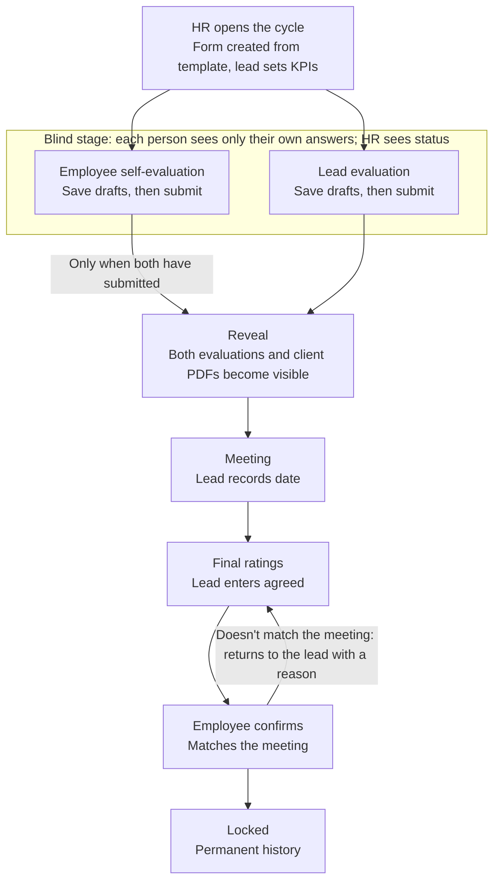
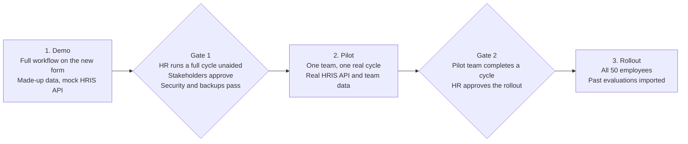

# Performance Evaluation System — PRD

Nov 9, 2026 · @Gayan

## Summary

Build a secure web app for 50 employees that replaces evaluation spreadsheets with one shared form per employee, per cycle. Employee and lead evaluate independently, see each other's answers only after both submit, then agree final ratings that lock permanently. Every completed evaluation becomes a web page in the employee's history, with that year's KPIs.

The work starts as a demo using made-up data, with employee details from a mock HRIS API. It moves to real HR use only after stakeholders approve it and it passes a pilot.

## Problem

The evaluation process runs on disconnected spreadsheets, so the company can't keep evaluations independent, agree outcomes traceably, or see performance over time.

| Pain today | Effect |
| --- | --- |
| Sheets are shared and stored separately | Nobody can be sure which version is current |
| Nothing hides one person's answers from the other | Seeing the other evaluation first can bias a rating |
| The two evaluations are combined by hand | Combining is slow, and the reasons for rating changes get lost |
| History is spread across old files | An employee's trend across years is hard to see |
| KPIs sit apart from the overall picture | KPI results are hard to find year by year |
| Client evaluations arrive separately as PDFs | Client feedback isn't kept with the evaluation it informs |

These pains come from the project owner's description of the current process. HR's time spent chasing late submissions is another likely pain.

## Goals

1. Keep every evaluation in one place, with one current version.
2. Guarantee that neither person sees the other's answers before both have submitted.
3. Record a final agreed rating that can't be changed after it locks.
4. Show each employee's evaluations and KPIs by year, as web pages.
5. Keep each client evaluation PDF with the employee's evaluation.
6. Show HR who has and hasn't completed each stage.

## Success measures

These are the agreed targets. No baseline from the current process has been measured yet.

| Measure | Proposed target | When |
| --- | --- | --- |
| HR runs a full cycle without help, from opening it to viewing the locked history page | Achieved in one session | Demo |
| Reads of the other person's answers before the reveal | 0 in API tests and audit-log reviews | Demo, pilot and every release |
| Changes to locked ratings | 0 in API tests and audit-log reviews | Demo, pilot and every release |
| Evaluations completed in the system during the pilot | All non-excluded forms in the pilot team | Pilot |
| Evaluations handled through spreadsheets | 0 of 50 employees | Rollout |
| Non-excluded forms submitted by their original submission deadline | 90% | Pilot and rollout |
| HR hours spent per cycle chasing and combining evaluations | Lower than a baseline measured from the last cycle | Rollout |
| Users who agree the process was fair, in a short survey after the cycle | 80% | Pilot and rollout |

## Users

Four roles use the system; clients stay outside it and send PDFs. One person can be both an employee and a lead.

| User | Needs |
| --- | --- |
| Employee | Complete a private self-evaluation, see the lead's evaluation after the reveal, confirm final ratings, read their own history |
| Lead | Evaluate each team member privately, hold the meeting, enter final ratings, read their current team's history |
| HR | Run cycles, manage templates, send invites, review HRIS sync results, track completion, upload client PDFs, read evaluations from the reveal onward |
| Client (no account) | Send a PDF evaluation, as they do today |
| Administrator | Set up and remove HR users, handle approved deletions, and step in when an HR person's own form needs HR action |

An administrator is a named person at the company who sets up the first HR user and manages the HR role, with every change logged. The first administrator account is created during system setup, outside the invite process. Senior leaders have no separate role in the first version.

### User journeys

| User | Journey |
| --- | --- |
| Employee | Receive invite, set password, read KPIs, complete and submit self-evaluation, read both evaluations, attend the meeting, confirm or return final ratings, read history |
| Lead | Publish KPIs, complete and submit each team member's evaluation, read both evaluations, hold the meeting, record its date, enter final ratings, read team history |
| HR | Review HRIS data and reporting lines, open the cycle, send invites, track progress, handle exceptions, upload client PDFs, read completed records |
| Administrator | Set up and remove HR users, and handle approved record deletions |

### Screens

1. Login and password setup: sign-in, invite and password reset
2. My tasks: what each person must do next, and when it's due
3. Evaluation form: own side, then both sides together after the reveal
4. Final ratings: lead entry, employee confirmation or return
5. Employee history: year selector, KPIs, ratings, comments and client PDFs
6. HR dashboard: stage of every form, overdue items, invite status, lead-change approvals and HRIS sync results
7. HR admin: cycles, the template, exceptions, correction notes, imports and the audit log
8. Administrator: HR role management and approved deletions

## Scope

The first version covers one annual review per cycle for one company of 50 employees.

### In scope

- Login with company email and a self-chosen password, set through an HR invite
- A new evaluation form designed for this process
- Blind submission, reveal, meeting record, final ratings and permanent lock
- KPI section inside the form
- Client PDF upload per employee and cycle
- Past evaluations as web pages, with KPIs shown by year
- HR dashboard, reminders, and cycle and template management
- Employee details and reporting lines read from the HRIS API, using a mock API first

### Out of scope

- Single sign-on
- Writing data back to the HRIS, or links to other HR systems
- Year-round KPI tracking
- Rating calibration
- Client logins
- Automatically reading scores from client PDFs
- Mobile apps

## Assumptions

These are the decisions the build follows, with no further HR approval needed. The last column shows the rework if one changes later.

| Topic | Default being built | Rework if changed later |
| --- | --- | --- |
| Submission order | Independent, in either order | Medium: changes visibility rules, stages and tests |
| HR during the blind stage | Sees status only | Low: widen one permission |
| Rating scale | The five-point scale in the evaluation form | Low: edit the template |
| Reviews per cycle | One annual review | High: changes cycles, history and the year selector |
| Form template | One fixed template per cycle, for all roles | High if each role needs its own form |
| When KPIs are set | Lead publishes them when the cycle opens | Medium: add a goal-setting stage earlier in the year |
| Client PDFs before the reveal | Only HR and the current lead can open them, so the lead isn't blind to client feedback | Low: limit reading to HR |
| Employee reads client PDFs | Yes, from the reveal onward | Low: remove one permission |
| No agreement reached | HR reviews the case and can close it as "Closed without agreement" | Medium: change the exception flow |
| Overall rating | Lead selects it; it isn't calculated | Medium: add scoring and weights |
| Pilot timing | Runs in the next scheduled review, while other teams keep their current process | High if no review falls within the pilot period |

Final ratings don't change after locking, even if they affect pay or promotion, and this system has no separate appeal route.

## Glossary

| Term | Meaning |
| --- | --- |
| Cycle | One review period that HR opens, such as the 2027 annual review |
| Form | One employee's evaluation record in a cycle |
| Side | The employee's or the lead's own answers on a form |
| Reveal | The moment both sides become visible, after the second side submits |
| Current team | A lead's direct reports, plus any form assigned through X5 |
| Included employee | A person HR selected for a cycle |
| Final states | Locked, Closed without agreement and Excluded |
| Stakeholders | HR, the project sponsor and the named gate approvers |
| HRIS | The company's HR information system, which holds employee details |
| Sync | The system reading employee details from the HRIS API |

## Workflow

Two gates define the product: the reveal happens only after both submit, and ratings lock only after the employee confirms them.

Either person can submit first, and neither waits for the other.

### Stages

Each form is always in exactly one stage, and any move not listed here is refused.

| Stage | Who acts | What moves it on | Blocked until then |
| --- | --- | --- | --- |
| KPI setup | Lead | Lead publishes KPIs | Employee can't start |
| Blind | Employee and lead | Both sides submit | Neither side can read the other |
| Revealed | Lead | Lead records the meeting date | Final ratings can't be entered |
| Final ratings | Lead | Lead sends ratings for confirmation | Employee can't confirm |
| Awaiting confirmation | Employee | Employee confirms, or returns with a reason | Ratings aren't locked |
| Returned | Lead | Lead corrects and resends | Employee can't confirm |
| In dispute | HR | HR records an outcome, or closes it | Ratings aren't locked |
| Locked | Nobody | End state | All changes except correction notes and approved deletions |
| Closed without agreement | Nobody | End state | All changes except correction notes and approved deletions |
| Excluded | Nobody | HR re-includes the employee while the cycle is open | All evaluation actions |

### Stage moves

| From | To | Who | Condition |
| --- | --- | --- | --- |
| KPI setup | Blind | Lead | KPIs published |
| Blind | Revealed | System | The second side submits |
| Revealed | Final ratings | Lead | Meeting date recorded |
| Final ratings | Awaiting confirmation | Lead | All final fields complete |
| Awaiting confirmation | Locked | Employee | Employee confirms |
| Awaiting confirmation | Returned | Employee | Employee gives a reason |
| Returned | Awaiting confirmation | Lead | Lead resends |
| Awaiting confirmation or Returned | In dispute | System | The second return, or 10 working days without a response |
| In dispute | Final ratings | HR | HR records the outcome (X10) |
| In dispute | Closed without agreement | HR | HR closes it (X6) |
| Any stage before Locked or Closed | Excluded | HR | HR records a reason (X3) |
| Excluded | The stage it left | HR | HR re-includes the employee while the cycle is open (X3) |

A form excluded before the reveal never reveals anything: submitted answers stay hidden from everyone and get no history page. A form excluded after the reveal keeps its page, labeled "Excluded".

Final states are Locked, Closed without agreement and Excluded. HR gets an alert when a lead misses a KPI, submission, meeting or final-ratings deadline, and again 5 working days later.

## Permissions

The server enforces these rules on every request; hiding something in the screen doesn't count as enforcement.

| Action | Employee | Lead | HR |
| --- | --- | --- | --- |
| Fill in the evaluation before submitting | Own | Current team | No |
| Read the other side's answers before the reveal | No | No | No |
| See a form's status at any stage | Own | Current team | All |
| Read answers from the reveal onward | Own | Current team | All |
| Upload a client PDF | No | Current team | All |
| Read a client PDF from the reveal onward | Own | Current team | All |
| Record the meeting and enter final ratings | No | Current team | No |
| Confirm final ratings | Own | No | No |
| Read past evaluations and KPIs | Own | Current team | All |
| Manage cycles and templates, and send invites | No | No | Yes |
| Change a locked rating | No | No | No |
| Edit HRIS employee details or reporting lines | No | No | No |
| Read a client PDF before the reveal | No | Current team | All |
| Use HR controls X1 to X7 and X10, approve lead changes, add correction notes, run a sync, enter imported evaluations | No | No | Yes |

HR staff can't use HR rights on their own record. Another HR person acts on their record; if there is none, the administrator can use HR controls on that one form, without reading answers before the reveal. A lead who is replaced loses access to that employee's records. The administrator manages the HR role and approved deletions, and has no other access to evaluations. "Current team" means direct reports, plus any form assigned through X5.

## Exceptions

These rules cover the cases most likely to stall a cycle.

| Case | Proposed behavior |
| --- | --- |
| One person misses the deadline | Answers stay hidden, reminders continue, and HR can extend the date, or exclude the form if it will never be completed |
| Someone submits by mistake | HR can reopen it before the reveal only, and the audit log records it |
| Lead changes mid-cycle | After HR approves the HRIS change, access moves to the new lead; a submitted evaluation stays, and an unsubmitted draft doesn't pass to the new lead |
| Employee doesn't confirm final ratings | After 2 returns or 10 working days, the form moves to In dispute and HR is alerted; HR resolves it or closes it as Closed without agreement |
| Mistake found after locking | Ratings stay unchanged, and HR adds a dated correction note beside them |
| New joiner or long leave | Joining after the KPI deadline or long leave means exclusion by default, with a recorded reason; otherwise HR adds them through X4 |
| Employee leaves mid-cycle | The HRIS sync stops their login, and HR excludes the form with a recorded reason |
| Lead leaves or goes on long leave with no replacement | HR names a temporary lead for that form |

## Evaluation form

This is a new form designed around the blind rule, KPIs and final agreement. Employee and lead answer the same questions separately, so the two evaluations compare line by line after the reveal.

### Form structure

| Part | What it asks | Employee | Lead | Required |
| --- | --- | --- | --- | --- |
| 1. Details | Name, employee ID, job title, department, lead and review period, filled in from the HRIS | Reads | Reads | Automatic |
| 2. KPIs | 3 to 6 KPIs, each with a name and target, set by the lead | Reads | Publishes before evaluation | Yes |
| 3. KPI results | For each KPI: result achieved, completion %, rating and evidence | Fills in own view | Fills in own view | Yes |
| 4. Competencies | Quality of work, ownership, collaboration, communication and learning: a rating and an example for each | Fills in own view | Fills in own view | Yes |
| 5. Overall view | Overall rating, main achievements, and challenges or support needed | Fills in own view | Fills in own view | Yes |
| 6. Development plan | 1 to 3 objectives for next year, each with an action and any support needed | Proposes | Proposes separately | Yes |
| 7. Client evaluations | Attached client PDFs | Reads after the reveal | Reads | No |
| 8. Final agreement | Meeting date, agreed KPI and competency ratings, overall rating, agreed development objectives and summary | Reads, may add a comment, then confirms | Completes after the meeting | Yes, except the employee's comment |

### Rating scale

Every rating in the form uses one five-point scale.

| Rating | Label | Meaning |
| --- | --- | --- |
| 5 | Outstanding | Far above the target, with impact beyond the role |
| 4 | Exceeds expectations | Above the target on a consistent basis |
| 3 | Meets expectations | Reached the target, with solid performance |
| 2 | Partially meets expectations | Reached some of the target, and needs improvement |
| 1 | Below expectations | Missed the target, and needs a clear improvement plan |

A rating of 1, 2 or 5 needs a written comment in that line's evidence or example field, including final ratings. The overall rating is a judgment rather than a calculated score. For competencies, "the target" means what the role expects. Completion % runs from 0 to 100, and stays blank when a KPI has no numeric target.

## Functional requirements

Each requirement below is written so it can be tested directly.

### Accounts and login

| ID | Requirement | Acceptance criteria |
| --- | --- | --- |
| A1 | Accounts and reporting lines come from the HRIS sync | Nobody can sign up without an HRIS record and an HR invite; each employee has one current lead, and the most senior person is excluded from cycles in the MVP; naming an evaluator for them is a pilot option |
| A2 | Users set their own password through an invite | The invite link works once and expires after 7 days; only approved company email domains are accepted |
| A3 | Users sign in with company email and password, and can reset the password | A wrong password never reveals whether an email exists; 5 failed attempts block login for 15 minutes |
| A4 | One person can be both employee and lead | The person sees their own form and their team's forms, each with the correct rights |
| A5 | HR sends and resends invites, and sees each person's invite status | Status shows not sent, sent, accepted or expired; an expired invite can be resent |

### Cycles and templates

| ID | Requirement | Acceptance criteria |
| --- | --- | --- |
| C1 | HR creates a cycle with a name, year, template and four deadlines: KPIs, submission, meeting and confirmation | HR selects which employees a cycle includes, and opening it creates one form for each, using the latest valid HRIS data |
| C2 | HR can edit labels, rating meanings and competencies by creating a new template version | Changing a template never alters a form already created from an earlier version |
| C3 | Each form keeps its template version | A past evaluation displays exactly the questions and scale it was completed on |
| C4 | Leads publish 3 to 6 KPIs for each team member by the KPI deadline | The employee can start only after publishing, and HR is alerted if the deadline passes; KPIs freeze at the first submission, and later changes need an HR reopen of each submitted side (X2), a log entry and an email to both people |
| C5 | A lead can edit published KPIs until the first submission | The employee is notified; draft answers on unchanged KPIs stay, and answers on a removed KPI are deleted after a warning to the lead |

### Blind evaluation

| ID | Requirement | Acceptance criteria |
| --- | --- | --- |
| E1 | Employee and lead each fill in their own side, and drafts save automatically | A draft survives logout and is visible only to its author; a warning appears before the session times out, and typed work isn't lost |
| E2 | Submitting requires all mandatory fields | Missing fields are named, and nothing is submitted until they're complete |
| E3 | The system warns that submitting may reveal both evaluations at once, and asks for confirmation, and a submitted side becomes read-only | Edit requests are refused, except after an HR reopen before the reveal |
| E4 | Neither side can read the other before the reveal | Screens, API responses, exports, notifications and logs contain none of the other side's answers, including through a direct API call |
| E5 | The form reveals automatically when the second side submits | Both people are notified, and the employee and lead evaluations display side by side |
| E6 | During Blind, each person sees only whether the other side has submitted | The screen shows submitted or not submitted, with no answers, ratings, draft progress or time |

### Client evaluations

| ID | Requirement | Acceptance criteria |
| --- | --- | --- |
| P1 | HR or the lead uploads client PDFs to an employee's form | Only PDF files up to 20 MB are accepted, and from the pilot onward they must pass a malware scan; client name and evaluation date are recorded |
| P2 | One form can hold more than one client PDF | Each PDF is listed separately and opens in the browser |
| P3 | Client PDFs follow the blind rule | Before the reveal, only HR and the current lead can list or open a PDF, including its name and count; a PDF added after the reveal is visible at once to the employee, lead and HR |
| P4 | Client PDFs lock with the form | No upload, replacement or removal is possible after locking; for a PDF arriving later, HR can record its receipt in a correction note |
| P5 | PDF links are protected | PDFs open only through a route that checks the signed-in user on every request, so a copied address fails for anyone without access |
| P6 | HR or the lead can remove a wrong PDF before locking | Before the reveal, HR or the lead can remove it; after the reveal, only HR can; removal needs a reason, appears in the audit log and hides the file instead of deleting it; a PDF covering several employees must be split before upload |

### Agreement and lock

| ID | Requirement | Acceptance criteria |
| --- | --- | --- |
| F1 | The lead records the meeting date | Final ratings can't be entered until the reveal has happened and a date is recorded; the date can't be in the future |
| F2 | The lead enters agreed KPI and competency ratings, an overall rating, agreed development objectives and a summary | Every required final rating must be filled in before sending for confirmation |
| F3 | The employee sees a warning that confirming is permanent, then confirms or returns the ratings | A return requires a reason and goes back to the lead; a second return, or 10 working days without a response since the last send, moves the form to In dispute |
| F4 | Confirmation locks the evaluation permanently | Every write to a locked form fails for every role, including HR and direct API calls, except correction notes and approved deletions |
| F5 | HR can add a dated correction note after locking | The note appears beside the record, the original ratings remain unchanged, and the employee and lead are notified |

### History and KPIs

| ID | Requirement | Acceptance criteria |
| --- | --- | --- |
| H1 | Every locked or closed evaluation becomes a read-only web page | The page shows both evaluations, final ratings, KPIs, meeting date, confirmation and client PDFs |
| H2 | Each employee has a history page with a year selector | Choosing a year shows that year's KPIs, ratings and comments |
| H3 | The KPI view shows each KPI's target, each side's result, completion % and rating, and the agreed rating, per year | Values match the locked form exactly; the page states they come from the review, not live tracking |
| H4 | The history page shows overall ratings across years | Years appear in order; individual KPIs aren't compared because they can change yearly; imported ratings keep their original scale label and aren't converted |
| H5 | Past-year access follows the permissions table | The employee, their current lead and HR can read the history; a direct link fails for anyone else |
| H6 | HR enters evaluations from before the system through a simple import form | Required fields are year, employee, lead and overall rating; other fields stay blank if missing; HR previews each page before saving; pages are labeled "Imported", keep their original rating scale and lock on saving; a past lead is stored as a name, without access; only HR can create them |
| H7 | HR can export one employee's full record | The export covers evaluations, KPIs, final ratings, notes and PDFs; an employee can ask HR for a copy or a correction note, and the audit log records it |

### HR tracking

| ID | Requirement | Acceptance criteria |
| --- | --- | --- |
| R1 | The dashboard shows each employee's stage across the cycle | HR can filter by team, stage and overdue, and sees no answers before the reveal |
| R2 | The system sends email notifications | Each email in the Notifications table goes to the people listed, at the time listed; no email contains answers or ratings |
| R3 | HR can export completion status | The export contains status only, not evaluation answers |

### HR controls

These actions handle exceptions, and each one needs a reason and appears in the audit log.

| ID | Requirement | Acceptance criteria |
| --- | --- | --- |
| X1 | HR can extend a form's deadline | The new date shows on the form and resets its reminders |
| X2 | HR can reopen a submitted side before the reveal | Only that side's author can edit it, and both people are notified without seeing any answers |
| X3 | HR can exclude an employee from a cycle | The form moves to Excluded, no longer counts as overdue, and reveals nothing new; HR can re-include the employee while the cycle is open |
| X4 | HR can add an employee to an open cycle | A new joiner gets a form using the cycle's template |
| X5 | HR can reassign a form when no lead is available | HR names a temporary lead, who gets access to that form only; the absent lead loses access to it, a sync doesn't undo the assignment, and the temporary lead starts blank unless the lead side was already submitted |
| X6 | HR can review and close a disputed form | Closing stores the lead's final ratings and the employee's written comment, then locks the form |
| X7 | HR can suspend a person's access immediately | Login stops and open sessions end at once, without waiting for a sync; HR can restore access, and a sync never reactivates a suspended person |
| X8 | HR can read the audit log | Only HR and the administrator can read it, and nobody can edit it |
| X9 | The system writes an audit event for every action in the audit log requirement | Each listed action, including refused access attempts, creates one event that can't be edited |
| X10 | HR can resolve a disputed form | HR records the outcome, the form returns to Final ratings, and the lead resends it for confirmation |

### Notifications

Emails carry only the event, the form's employee name where needed and a link that requires login.

| Event | Who is notified | When |
| --- | --- | --- |
| Invite or password reset | That person | On request |
| Email address changed | Old and new addresses | After the sync |
| Cycle opened | Included employees and their leads | When HR opens it |
| KPIs published or edited | Employee | At once |
| Deadline approaching | People who haven't acted | 7 and 2 days before |
| Deadline passed | People who haven't acted, and HR for lead steps | Every 3 working days |
| Side reopened | Both people | At once |
| Reveal | Employee and lead | At once |
| Final ratings sent, or a form returned | The next person to act | At once |
| Form locked or closed | Employee, lead and HR | At once |
| In dispute, or a lead change to approve | HR | At once |
| Form assigned to a temporary lead | Employee, temporary lead and absent lead | At once |
| Client PDF added after the reveal | Employee and lead | At once |
| Correction note added | Employee and lead | At once |
| Bounced email, or a failed or paused sync | HR | At once |

A bounced email is shown on the HR dashboard, and the system retries it once.

## HRIS integration

The HRIS is the source of truth for employee details and reporting lines, and this system only reads from it. The demo and early build use a mock API with 50 made-up employees, and real HRIS integration comes later, as separate work before the pilot.

Passwords stay in this system because the HRIS doesn't handle login here. Evaluations, ratings and KPIs are never sent to the HRIS.

### Employee data

The API returns only the fields below; salary, bank and other unneeded personal data must not be requested. The real HRIS may use different names, so the fields are a proposal until its API is confirmed.

| Field | Used for | Required |
| --- | --- | --- |
| Employee ID | Matching a person across syncs and years | Yes |
| Full name | Forms, dashboard and history | Yes |
| Company email | Invite and login | Yes |
| Lead's employee ID | Reporting line and form access | Yes, except the most senior person |
| Employment status | Active and on-leave people keep login; a terminated person loses it | Yes |
| Job title | Form and history display | Yes |
| Department or team | HR dashboard filter | Yes |
| Start date | Identifying new joiners | Yes |
| Last updated time | Fetching only changed records | If the HRIS supports it |

### Sync requirements

| ID | Requirement | Acceptance criteria |
| --- | --- | --- |
| S1 | The system syncs employee data every day, and HR can start a sync manually | Each run records its start time, result and number of records changed |
| S2 | The system matches people by employee ID | A changed name or email updates the existing person, their history stays attached, and an email change notifies both addresses |
| S3 | New employees are added automatically | HR sees them on the dashboard and sends the invite; no account becomes active without one |
| S4 | Employees marked inactive lose access | Login stops after the sync, and their evaluation records remain; a rehired person with the same employee ID keeps their history and needs a new invite |
| S5 | A lead change updates access | The old lead keeps access until HR approves or rejects the change; approval moves access, rejection means HR corrects the HRIS, and deadlines continue unless HR extends them |
| S6 | Locked records keep their original details | A later sync never changes the name, job title or lead shown on a locked evaluation |
| S7 | Invalid records don't apply | A record with a missing required field, duplicate email or unknown lead keeps its last valid version and appears on an HR error list, but inactive status always applies |
| S8 | A failed sync does no harm | The system keeps its last valid data and shows HR the failure; login and open evaluations continue to work |
| S9 | HRIS fields are read-only here | Screens and APIs refuse any edit; corrections are made in the HRIS and arrive with the next sync |
| S10 | The design makes the mock API easy to replace | HRIS connection code stays apart from workflow code; the effort to switch is confirmed once the real API is reviewed |
| S11 | Unusual results raise an alert | After the first load, a missing person, an empty response or changes to more than 20% of records pause the sync; HR approves or discards the pending changes |
| S12 | HR reviews reporting lines before opening a cycle | A cycle can't open until HR confirms the list |

The HRIS doesn't decide who has the HR role in this system. An administrator assigns it here, while lead access comes from the reporting lines.

### Mock API

The mock provides a repeatable way to test every sync outcome without access to real employee data. Its endpoints are `GET /employees`, with an optional changed-since filter, and `GET /employees/{id}`, both requiring an API key.

| Mock scenario | Expected result |
| --- | --- |
| Normal list of 50 employees | All 50 are created with correct reporting lines |
| New joiner | Person is added and shown to HR for an invite |
| Employee leaves | Login stops, and records remain |
| Lead changes mid-cycle | Access moves, and the open form is flagged |
| Name or email changes | Existing person is updated, and locked records don't change |
| Missing field, duplicate email or unknown lead | Record isn't applied and appears on the error list |
| API down, timeout or wrong API key | Sync fails safely, and HR sees the failure |
| Person missing, or an empty response | Sync pauses, and HR is alerted |

## Quality requirements

Evaluations are sensitive personal data, so security and privacy rules apply from the demo onward. The numeric targets are proposals suited to 50 users. Access control, encryption, passwords, the audit log and demo data apply from the demo, except two-step verification; the rest apply before the pilot.

| Area | Requirement |
| --- | --- |
| Access control | The database and server enforce the permissions table, so the screens aren't the only barrier |
| Passwords | At least 12 characters, stored only as secure hashes, and unreadable by anyone including HR; sessions end after 30 idle minutes; HR and administrator logins use two-step verification from the pilot onward |
| Encryption | HTTPS for all traffic; data and PDFs encrypted when stored |
| Audit log | Records reveals, HR control actions, lead-change approvals, KPI changes, PDF uploads and removals, final ratings, confirmations, returns, correction notes, template and HR role changes, deletions, HR reads of evaluations and refused access attempts; nobody can edit it |
| Privacy | Before real data is used, hosting location and retention periods are checked against Sri Lanka's Personal Data Protection Act; vendor contracts, a breach response plan and an employee privacy notice are in place |
| Backups | Daily backups with a tested restore before the pilot; at most 24 hours of data lost and service restored within 1 working day; after any restore, HR checks forms against lock emails, and anyone whose confirmation was lost confirms again |
| Performance | Pages load within 2 seconds with 50 active users on a 20 Mbps connection; the system is available 99% of the time during review periods |
| Browsers | Current Chrome, Edge, Safari and Firefox; pages usable on a phone browser |
| Accessibility | Forms and history pages work by keyboard and meet WCAG 2.1 AA |
| Demo data | Made-up people and comments only; no real evaluations are used; demo data stays in a separate environment and never moves to the pilot |
| HRIS connection | Read-only access; the API key stays on the server; only the listed fields are requested and stored |
| Production access | Database admin tools can bypass the app's rules, so at most two named people hold that access; use is logged and reviewed at each gate |
| Record deletion | Locked records are deleted only when a retention rule or law requires it, by the administrator, with HR approval and a log entry |
| Time and language | Sri Lanka time (UTC+5:30), with deadlines ending at 23:59; working days are Monday to Friday, excluding company holidays, which are seeded for the MVP and entered by HR from the pilot; the app is in English only |
| Errors and monitoring | Users see a plain error message and keep their typed work; the support owner is alerted to app errors and failed syncs within 15 minutes |

The system will be used in Sri Lanka. Sri Lanka's Personal Data Protection Act No. 9 of 2022, as [amended by Act No. 22 of 2025](https://dpa.gov.lk/acts/22-2025_E_251104_201549.pdf), has [key provisions taking effect on 1 January 2027](https://www.ft.lk/front-page/Data-protection-compliance-regime-takes-effect-on-1-Jan-2027/44-795776). They cover lawful processing, Data Protection Officers, breach notices, impact assessments, processor contracts and cross-border transfers.

The legal review should confirm how the Act applies to employee evaluations, and whether hosting outside Sri Lanka needs extra safeguards.

## Data model

Each evaluation keeps a fixed copy of its template, so changes to a template can't rewrite history.

| Record | Holds | Key rule |
| --- | --- | --- |
| User | HRIS employee ID, name, company email, job title, department, roles, active status | One person can be both employee and lead |
| Reporting line | Employee, lead, start and end dates | Comes from the HRIS; past leads stay on record without keeping access |
| Template version | Sections, questions and rating lists | Can't be edited once used by a form |
| Cycle | Name, year, deadlines, template version | One annual review in the first version |
| Evaluation form | Employee, lead, temporary lead, cycle, current stage, deadlines, meeting date, imported label | One per employee, per cycle; keeps a copy of employee and lead details once locked |
| Evaluation side | Author type and ID, answers, KPI results, submitted time | One employee side and one lead side per form, in separate records so the database can hide each one |
| KPI | KPI name and target, set by the lead | Belongs to one form, which keeps each year's values separate |
| Client evaluation | Client name, date, stored PDF, uploader | Follows the form's reveal and lock rules |
| Final result | Agreed KPI and competency ratings, overall rating, development objectives, summary, employee comment, return reasons, confirmation time | Can't change after confirmation |
| Correction note | Text, author, date | Added beside a locked result, never replacing it |
| Audit event | Who, what, which record, why, when | Add-only |
| HRIS sync run | Start time, result, records changed, rejected records | A failed run leaves existing data unchanged |
| Invite | Person, status, sent and expiry times | A resend replaces the earlier link |
| Pending lead change | Employee, old lead, new lead, HR decision, date | Access moves only after approval |

## Technology

The recommendation is one web application and one managed database, which is the simplest setup that meets these rules for 50 users.

| Part | Choice | Why |
| --- | --- | --- |
| Web app | Next.js with TypeScript | One codebase for screens and server logic |
| Database, login and PDF storage | Supabase (PostgreSQL) | Covers all three, and row-level security can enforce the blind rule in the database |
| Hosting | Vercel | Simple deployment and an easy demo link |
| Email | Transactional email service, to be chosen | Sends invites, resets and reminders |
| Testing | Playwright | Covers UI and API tests in one tool |
| Employee data | Mock API first, then the real HRIS API | The build can start without HRIS access, and sync failures can be tested on demand |

## Test strategy

The highest-priority tests prove that the blind rule and the lock can't be bypassed, because a single failure would damage trust in every evaluation.

| Level | Focus | Example |
| --- | --- | --- |
| API permissions | Every role against every stage and record | An employee requests the lead's answers before the reveal, including through Supabase's automatic API, and is refused |
| Workflow | Every allowed and blocked stage change | Final ratings are refused before a meeting date exists |
| Lock | Every write path on a locked form | HR's request to change a final rating is refused |
| Data leak | Other routes to hidden answers | Emails, exports, logs and PDF links reveal nothing early |
| End to end | The full cycle across three roles | Open, submit, reveal, meet, finalize, confirm, then read the history page |
| Template history | Old forms after template changes | A past evaluation still displays its original questions |
| Accessibility and browsers | Main screens | Keyboard-only completion of the form passes, and an accessibility audit runs before the pilot |
| HRIS sync | Every mock scenario, plus contract checks against the real API before the pilot | A lead change moves access, and locked records stay unchanged |
| Simultaneous actions | Actions that collide in time | Both sides submit together, or HR reopens during a submit, and the form ends in one valid stage |
| Operations | Restore, password reset, email, upload limits, performance and import | A restored backup keeps locked records locked |

The API permission, lock and data leak tests run on every code change, and any failure blocks the release. Every requirement ID and quality requirement links to at least one test.

## Delivery

Three phases move from made-up data to all 50 employees, and each needs a gate approval. All current work uses the mock API, and real HRIS integration comes later, before the pilot starts. Dates are still to be set, after the open questions below are answered.

### Requirements by phase

The demo proves the main path with one fixed template, and every demo requirement must pass for Gate 1. Later phases add exception handling and what real data needs. Requirements carry forward once delivered.

| Phase | Requirements | Also needed |
| --- | --- | --- |
| Demo | A1 to A5, C1, C3 to C5, E1 to E6, P1 to P4, F1 to F5, H1 to H3, H5, R1, R2, X2, X6, X8 to X10, S1 to S3, S9, S10 | Mock API with 50 made-up employees, test logins and inboxes for each role, and a way to trigger each mock scenario; security, backup and accessibility checks before Gate 1 |
| Pilot | C2, H4, H7, R3, P5, P6, X1, X3 to X5, X7, S4 to S8, S11, S12 | Real HRIS API, malware scanning, two-step login, short user guide and training |
| Rollout | H6 | Support owner in place, past evaluations imported |

With one annual review, pilot and rollout could be up to a year apart unless HR runs an off-cycle pilot.

If the system fails during the pilot, the pilot team finishes that cycle in its current process. Pilot records already locked stay locked, and any errors get correction notes.

## Risks

The largest risk is hidden answers leaking before the reveal, because one leak would damage trust in every evaluation.

| Risk | Mitigation |
| --- | --- |
| Answers leak before the reveal | Enforce access in the database and block releases on API tests |
| A demo reaches real use without being hardened | Build with real access rules from the start, and require Gate 1's security and backup checks |
| Real evaluations end up in the demo | Use only made-up data, and keep demo and live environments separate |
| The system has no long-term owner | Name who supports and maintains it before Gate 1 |
| Leads or employees don't adopt it | Pilot with one team first, and test the new form with a few leads and employees |
| The real HRIS API differs from the mock | Get its documentation early, keep field mapping apart from workflow code, and run contract checks before the pilot |
| HRIS reporting lines are wrong or out of date | Have HR review reporting lines before opening a cycle, because a wrong lead could see someone's evaluation |

## Dependencies

Dates remain to be set, and the owners below are proposed roles until people are named.

| Dependency | Owner | Needed by |
| --- | --- | --- |
| HRIS API documentation, test access and field approval | HR and IT | Before HRIS integration |
| Named gate approvers and administrator | HR | Gate 1 |
| Named builder, needed now for the demo | Project sponsor | Gate 1 |
| Hosting, email and malware-scanning services | Project owner | Demo for hosting and email; pilot for scanning |
| Legal and privacy review under Sri Lanka's Personal Data Protection Act | HR and legal adviser | Gate 1 |
| Review calendar for the pilot | HR | Gate 1 |
| Support and maintenance owner | Project sponsor | Gate 1 |
| Baseline of HR hours from the last cycle | HR | Gate 1 |
| Technical check that the stack meets session ending, lockout, 20 MB uploads and PDF backups | Builder | Before the demo build |

## Open questions

The build continues on the defaults in Assumptions, and each question should be closed before the gate shown. Reviews per cycle, per-role forms and pilot timing should come first, because they carry the most rework.

- [ ] Decide whether the lead may see client PDFs before submitting; a lead who receives or uploads one already has (Gate 1)
- [ ] Confirm that employees may read client PDFs, and that clients have been told (Gate 1)
- [ ] Decide the number of reviews per cycle (Gate 1)
- [ ] Choose which approved email domains can sign in (Gate 1)
- [ ] Check hosting location and retention periods against Sri Lanka's Personal Data Protection Act (Gate 1)
- [ ] Share HR's review calendar and confirm the pilot's timing (Gate 1)
- [ ] Confirm who builds this (Gate 1)
- [ ] Confirm how many HR staff there are, and name the administrator and gate approvers (Gate 1)
- [ ] Decide whether ratings affect pay or promotion, and whether an appeal route is needed (Gate 1)
- [ ] Confirm whether each role needs its own form or competencies (Gate 1)
- [ ] Identify the HRIS product, and get its API documentation, test access and approval for the listed fields (before HRIS integration)
- [ ] Confirm that the HRIS holds a correct lead for all 50 employees (before HRIS integration)
- [ ] Confirm that a daily sync is often enough, and that the HRIS allows it (before HRIS integration)
- [ ] Name who supports and maintains the system (Gate 1)
- [ ] Decide how many past years to import (Gate 2)
